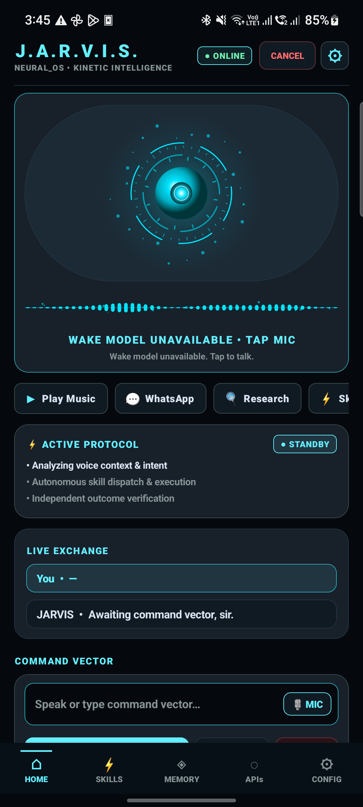
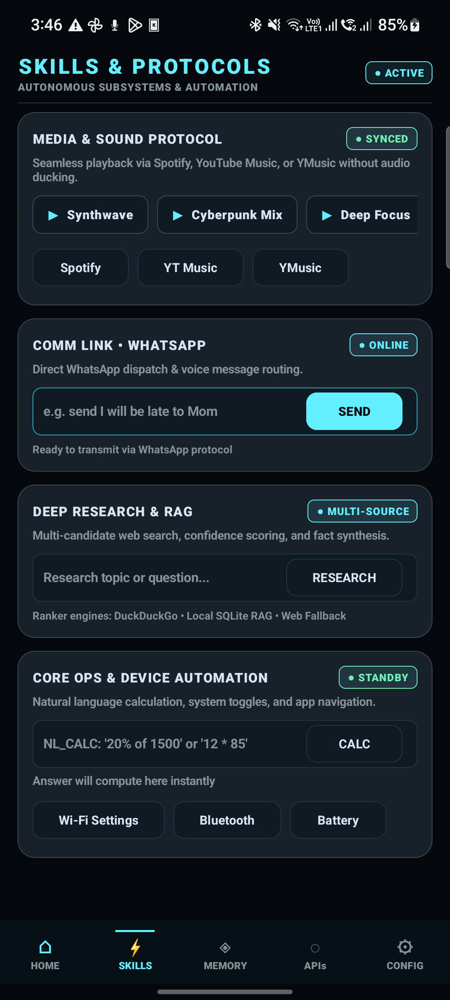

# 🤖 J.A.R.V.I.S. — Autonomous Android AI Super-Agent & Voice Assistant

[](https://github.com/1209codex/android-jarvis)
[](https://github.com/1209codex/android-jarvis)
[-00E676?style=flat-square)](https://github.com/1209codex/android-jarvis)
[-00E5FF?style=flat-square)](https://github.com/1209codex/android-jarvis)
[](dist/jarvis-v1.0-release.apk)

**J.A.R.V.I.S.** (*Just A Rather Very Intelligent System*) is a fully autonomous, closed-loop Android AI super-agent and personal voice assistant. Built for privacy-first, on-device intelligence, J.A.R.V.I.S. integrates continuous on-device wake-word detection (quantized INT8 TFLite keyword spotter), multi-provider LLM reasoning (Groq `openai/gpt-oss-20b` / `openai/gpt-oss-120b`, Gemini `gemini-2.5-flash`, OpenRouter, and local Ollama), Bluetooth earbud SCO routing with physical button hook interception, WearOS companion synchronization with signature security, fail-closed policy execution, computer vision perception (`qwen/qwen3.6-27b`), on-device hybrid RAG memory, and deep OS-level accessibility automation.

---

## 📱 User Interface & Visual Showcase (Google Stitch Material 3)

The user interface is built on **Google Stitch** (*Project `3145573286617872806`*), adhering to Material 3 cyber-slate aesthetics: deep `#05090D` kinetic background, `#63EFFF` holographic cyan glow, glassmorphic container panels, fluid waveforms, and voice-first ergonomics.

<div align="center">
  <table align="center" width="100%">
    <tr>
      <th align="center" width="50%"><b>Dashboard HUD (Live Device)</b></th>
      <th align="center" width="50%"><b>Skills Command Deck (Live Device)</b></th>
    </tr>
    <tr>
      <td align="center">
        <a href="docs/stitch/device_screenshot_fixed.png">
          
        </a><br/>
        <sub><b>Interactive Arc Reactor Orb • Live Waveform • Smart Command Bar • Active Protocol Tracker</b></sub>
      </td>
      <td align="center">
        <a href="docs/stitch/device_screenshot_skills.png">
          
        </a><br/>
        <sub><b>Modular Capability Decks • Instant One-Touch Automations • Telephony & WhatsApp Hub</b></sub>
      </td>
    </tr>
  </table>
</div>

---

## 💎 App Screens & UI Architecture

The app is organized into **5 core navigation tabs** along with a persistent HUD:

### 1. 🏠 Home Dashboard (`HOME`)
- **Top HUD Bar**: Displays service connectivity state (`● READY`, `● ONLINE`, `● HALTED`), one-tap service toggle, active task cancellation, and direct Settings shortcut.
- **Hero Arc Reactor Orb (`JarvisOrbView`)**: Holographic multi-particle orbital core with dynamic pulsing and real-time audio reactivity.
- **Live Fluid Waveform (`JarvisWaveformView`)**: Visualizes live microphone frequency amplitudes during speech listening and TTS output.
- **Context-Aware Active Protocol Tracker**: Appears dynamically during multi-step task execution showing live stages (`PLANNING`, `EXECUTING`, `VERIFYING`) with an instant cancel button.
- **Live Exchange Conversation Log**: Cyber-slate dialogue bubbles showing your spoken/typed request and J.A.R.V.I.S.'s spoken response.
- **Unified Smart Command Bar**:
  - 🎙 **Mic Icon** (Cyan): Tap to trigger instant manual voice listening.
  - ➤ **Send Icon** (Blue): Appears automatically when text is entered to dispatch typed commands.
  - ⏹ **Stop Icon** (Red): Appears during active speech or background tasks to immediately halt operations.

### 2. ⚡ Skills & Automations Deck (`SKILLS`)
- **🎵 Music & Entertainment Protocol**: Hardware media transport controls (`⏮ Prev`, `▶ Play`, `⏸ Pause`, `⏭ Next`, `⏹ Stop`), instant genre preset chips (`Synthwave`, `Lo-Fi Chill`, `Deep Focus`, `Top Hits`, `Workout Mix`), and quick launchers for Spotify, YouTube Music, and YMusic.
- **📞 Phone Calls & Telephony Agent**: One-touch telephony triggers (`🟢 ANSWER`, `🔴 REJECT`, `✉️ READ SMS`, `🔑 GET OTP`).
- **💬 WhatsApp & Smart Messaging**: Background unread message reader (`💬 READ UNREAD`), situational auto-responders (`🚗 AUTO-REPLY (DRIVE)`, `⏹ OFF`), and direct message transmission composer.
- **👁️ Camera Vision & Optical Perception**: Instant optical AI triggers (`👁️ WHAT IS THIS?`, `📖 READ TEXT`, `🤳 SELFIE SCAN`).
- **🛡️ Autopilot & Situational Modes**: Hands-free mode switches (`🚗 DRIVING MODE`, `📅 MEETING MODE`, `🤖 STATUS`).
- **⚡ Device Controls & Shortcuts**: Instant hardware toggles (`📶 WI-FI`, `📡 BLUETOOTH`, `🔋 BATTERY`) and an embedded Natural Language Calculator (`NL_CALC`).

### 3. 🧠 Neural Memory Core (`MEMORY`)
- **Health Metrics HUD**: Displays live counts for Active Facts, User Preferences, Document Chunks, and Messages.
- **Memory Store**: Browse, search, filter by category (`USER_PREFERENCE`, `EPISODIC_EVENT`, `FACTUAL_KNOWLEDGE`, `HABIT_PATTERN`), add custom memories, and archive outdated facts.
- **Retrieval Simulator & Benchmarking**: Inspect cross-encoder re-ranking, BM25 keyword relevance, vector cosine similarity, and candidate source attribution.
- **Garbage Collector & Half-Life Decay**: Real-time half-life decay visualization with automated memory pruning.

### 4. 🔑 API & Model Manager (`APIS`)
- **Hardware-Backed Keystore**: Visual badge confirming AES-GCM-256 Android Keystore credential encryption.
- **Active Reasoning Models**: One-tap selection across multi-provider LLM models:
  - `openai/gpt-oss-20b` (Default high-speed reasoning, planning & tool use)
  - `openai/gpt-oss-120b` (Deep multi-turn planning & complex decomposition)
  - `gemini-2.5-flash` / `gemini-2.5-pro` (Google Gemini provider with multimodal analysis)
  - `qwen/qwen3.6-27b` (Multimodal vision and screen understanding)
  - `llama3.2` via local Ollama (`http://10.0.2.2:11434` or custom endpoint)
- **Active Endpoints & Ping Testing**: Live endpoint status with real-time latency ping verification (`TEST PING`).

### 5. ⚙️ System Settings & Diagnostics (`CONFIG`)
- **Voice & Acoustic Customization**: Personal Voice Wake-Word Enrollment & Calibration Wizard, custom wake-word string, wake acknowledgment sounds (*"Yes Sir"*, *"At your service"*, *"Ready"*, Chime), continuous conversation toggle, full-duplex barge-in switch, and offline ASR toggle.
- **Proactive Contextual Intelligence**: Battery warning toggles, calendar pre-briefing lead time picker (5m, 10m, 15m, 30m), and interactive Daily Morning Briefing time picker (`HH:mm`).
- **Bluetooth & Wearables**: Bluetooth SCO earbud audio routing toggle, earbud hook button interception toggle, and WearOS sync toggle.
- **Automation Behaviors**: Lock-screen voice HUD overlay toggle, WhatsApp auto-return home toggle, and media ducking level selector (10%, 20%, 30%, 50%).
- **Embedded Diagnostics & Logs**: Live system logcat viewer with `X-Jarvis-Correlation-Id` tracing, log clear, and copy diagnostics.

---

## 📖 Complete Feature Guide & How to Use Every Feature

### 1. 🎙️ Continuous Wake-Word Detection (Hands-Free Activation)
- **What it does**: Continuously monitors the microphone for the wake phrase (*"Hey Jarvis"* or *"Jarvis"*) using a quantized INT8 TFLite keyword spotter on a dedicated `VOICE_RECOGNITION` audio stream with 2-second pre-roll audio handoff for seamless same-breath command capture.
- **How to use via Voice**:
  - Simply say *"Hey Jarvis"* or *"Jarvis"* at normal speaking volume from anywhere in the room.
  - J.A.R.V.I.S. chimes or responds (*"Yes sir"*) and enters active listening mode.
- **How to use on Lock Screen**:
  - The display turns on automatically upon hearing the wake word (`showWhenLocked="true"`, `turnScreenOn="true"`). The holographic Arc Reactor HUD appears over the lock screen so you can issue commands without unlocking your phone.
- **Settings**: Adjust wake word phrase, acknowledgment style, and lock-screen HUD toggle under **CONFIG**.

---

### 1.1 🎚️ Personal Voice Wake-Word Enrollment & Acoustic Calibration
- **What it does**: Calibrates the on-device keyword spotter directly to your unique vocal timbre, accent, articulation clarity, and ambient microphone noise floor. Rather than relying solely on a fixed generic detection threshold, J.A.R.V.I.S. tailors a personalized `UserVoiceProfile` using 3 guided utterances.
- **How to use via Settings (`CONFIG`)**:
  - Go to the **CONFIG** tab and scroll to **Wake Engine & Audio Contract**.
  - Under **Personal Acoustic Calibration**, tap `🎙 ENROLL / RE-CALIBRATE`.
  - The **Voice Calibration Wizard** modal opens:
    1. Tap `RECORD SAMPLE 1`, speak *"Jarvis"* clearly at your normal speaking distance (real-time cyan speech energy meter visualizes volume).
    2. The engine instantly validates duration ($\ge 0.4$s), speech energy ($\text{RMS} \ge 70.0$), microphone clipping distortion ($< 3\%$), and model confidence.
    3. Repeat for `SAMPLE 2` and `SAMPLE 3`.
    4. Upon completion, view your **Average Wake Confidence**, **Calibrated Detection Threshold**, and **Calibrated Noise Floor**.
    5. Tap `SAVE & ACTIVATE` to apply your personalized profile immediately into the live detection pipeline without restarting the service.
  - **Revert anytime**: Tap `↺ RESET TO DEFAULT` to restore the factory TFLite acoustic profile instantly.

---

### 1.2 ⚡ Lazy Subsystem Container & Cold-Start RAM Optimization
- **What it does**: Segregates core boot-critical subsystems (Wake-Word Engine, Event Bus, World State Store, Device Guardian) from heavy, memory-intensive modules (Camera2 Perception, TFLite Vision Detectors, SQLite Knowledge Vaults, RAG dense vector stores, WhatsApp accessibility automations, Telephony, and Sherpa-ONNX/TTS).
- **Zero Cold-Start Lag**: Only lightweight audio wake-word detection and reactive coordination are loaded at service startup, reducing foreground service memory consumption by up to ~65% and eliminating boot-time ANR risks.
- **LazyTool Metadata Discovery**: All autonomous planning engines discover tool parameters, names, risk levels, and confirmation policies at startup without instantiating underlying hardware drivers.
- **OS Memory Pressure Eviction (`onTrimMemory`)**: Hooks directly into Android's `ComponentCallbacks2` memory warning signals (`TRIM_MEMORY_RUNNING_LOW`, `TRIM_MEMORY_RUNNING_CRITICAL`, `TRIM_MEMORY_UI_HIDDEN`). When the OS signals RAM pressure, J.A.R.V.I.S. automatically evicts idle vision models, flushes in-memory RAG query vector caches, and reclaims heap memory transparently without dropping wake-word listening.

---

### 2. 🔘 Hero Arc Reactor & Manual Tap-to-Talk
- **What it does**: Provides a physical touch alternative to the wake word.
- **How to use via Touch**:
  - Tap the center **Arc Reactor Orb** on the **HOME** dashboard at any time.
  - The orb expands into an active cyan pulse and the waveform starts capturing your voice immediately.
  - While J.A.R.V.I.S. is speaking, tapping the orb acts as an instant manual **barge-in interrupt**, silencing speech and preparing for your next command.

---

### 3. ⌨️ Unified Smart Command Bar (Voice & Keyboard)
- **What it does**: Accommodates both spoken and typed commands in a single sleek container.
- **How to use**:
  - **Voice**: Tap the cyan 🎙 **Mic** icon on the right side of the pill bar to speak.
  - **Text**: Tap the input field, type any request (e.g. *"turn on flashlight"*, *"who is the president of France"*, *"whatsapp Alex I am home"*), and tap the blue ➤ **Send** icon or press the keyboard Enter key.
  - **Cancel**: Tap the red ⏹ **Stop** icon to abort any running action.

---

### 4. 🎧 Bluetooth Earbud Audio Routing (Bluetooth SCO)
- **What it does**: Automatically routes bidirectional audio through connected Bluetooth earbuds, neckbands, or headsets (Galaxy Buds, AirPods, Sony WH/WF, Bose, OnePlus Buds) via low-latency Bluetooth SCO (`setCommunicationDevice` on Android 12+, `startBluetoothSco` on Android 8-11).
- **How to use**:
  - Connect your Bluetooth earbuds to your phone as usual.
  - J.A.R.V.I.S. automatically detects the connected headset and routes microphone input and speech output through the earbud.
  - You can speak in a soft whisper hands-free while your phone remains safely in your pocket or backpack.
- **Settings**: Toggle `Bluetooth SCO Earbud Routing` on/off in the **CONFIG** tab.

---

### 5. 🎛️ Earbud Button Interception (Physical Tap-to-Talk & Barge-In)
- **What it does**: Listens for media button events on connected Bluetooth earbuds or wired headsets (`KEYCODE_HEADSETHOOK`, `KEYCODE_MEDIA_PLAY_PAUSE`, `KEYCODE_MEDIA_PLAY`) via Android's native `MediaSession`.
- **How to use via Hardware**:
  - **Single click earbud button while idle**: Wakes J.A.R.V.I.S. into active voice listening immediately with acoustic confirmation.
  - **Single click earbud button while Jarvis is speaking**: Instantly silences ongoing speech (physical barge-in) and awaits your next instruction.
  - Built-in 400ms debounce filter prevents accidental double-click conflicts.
- **Settings**: Toggle `Headset Hook Activation` in the **CONFIG** tab.

---

### 6. ⌚ Smartwatch & WearOS Companion Synchronization
- **What it does**: Bridges wrist smartwatches and WearOS tiles with J.A.R.V.I.S. on your phone via broadcast intents and rich wearable notification cards.
- **How to use via Wearable Notifications**:
  - Swipe to the persistent J.A.R.V.I.S. notification on your smartwatch to reveal WearableExtender action cards:
    - `🎙 Talk`: Wakes phone into active listening.
    - `🛑 Stop`: Halts current task, music, or speech.
    - `🚗 Drive`: Toggles Driving Autopilot mode.
- **How to use via Watch Apps / Automation (Tasker / Macrodroid / Watchmaker)**:
  - Broadcast `com.jarvis.wear.action.WEAR_WAKE` to wake J.A.R.V.I.S.
  - Broadcast `com.jarvis.wear.action.WEAR_COMMAND` with an extra `command` string to run any command silently.
  - Broadcast `com.jarvis.wear.action.WEAR_STOP` to cancel tasks.
- **Settings**: Toggle `Wearable Companion Sync` in the **CONFIG** tab.

---

### 7. ⚡ Full-Duplex Voice Streaming & Acoustic Barge-In Interruption
- **What it does**: Delivers true full-duplex conversational interaction. You can interrupt J.A.R.V.I.S. at any second while it is speaking without waiting for it to finish.
- **How to use via Voice**:
  - While J.A.R.V.I.S. is speaking, simply say *"Jarvis"* or *"Stop"*.
  - The acoustic energy detector and wake-word engine immediately silence TTS output (<50ms) and open the microphone for your correction or next command.
- **Echo Guard**: Hardware `AcousticEchoCanceler` and calibrated speaker playback thresholding prevent J.A.R.V.I.S. from interrupting its own voice.
- **Settings**: Toggle `Full-Duplex Barge-In` and `Continuous Conversation` in the **CONFIG** tab.

---

### 8. 📞 Hands-Free Phone Calls & Telephony Agent
- **What it does**: Announces incoming callers hands-free and lets you answer, reject, or place phone calls using pure voice commands.
- **Incoming Caller Announcement**:
  - When your phone rings, J.A.R.V.I.S. resolves the contact name and speaks: *"Incoming call from Rahul. Say 'answer' or 'reject'."*
- **Voice Commands**:
  - **Answer**: *"answer"*, *"answer call"*, *"phone uthao"*, *"call receive karo"* $\to$ Answers via `TelecomManager.acceptRingingCall()`.
  - **Reject**: *"reject"*, *"reject call"*, *"call kaat do"*, *"decline"* $\to$ Hangs up via `TelecomManager.endCall()`.
  - **Make Call**: *"call Mom"*, *"phone lagao Rahul"*, *"dial 9876543210"*.
- **Touch Controls**: Tap `🟢 ANSWER` or `🔴 REJECT` on the **SKILLS** screen under the Telephony card.

---

### 9. ✉️ SMS Reading & Automated OTP / 2FA Extraction
- **What it does**: Reads incoming text messages out loud and automatically detects and extracts 4-to-8 digit verification OTP codes from banks, Google, and delivery services.
- **Voice Commands**:
  - *"what is my otp"*, *"otp batao"*, *"check otp"* $\to$ J.A.R.V.I.S. parses your latest SMS and speaks: *"Your OTP is 482910"*.
  - *"read sms"*, *"sms padho"*, *"read latest message"* $\to$ Reads out recent unread messages.
  - *"send sms to Rahul saying I am arriving in 10 minutes"* $\to$ Dispatches SMS automatically.
- **Touch Controls**: Tap `✉️ READ SMS` or `🔑 GET OTP` on the **SKILLS** screen.

---

### 10. 💬 Autonomous WhatsApp Subsystem & 3-Tier Messaging
- **What it does**: Dispatches WhatsApp messages and auto-replies autonomously using a 3-tier execution architecture:
  - **Tier 1 (Background Quick-Reply)**: Answers directly through Android `RemoteInput` notification channels with zero screen disruption.
  - **Tier 2 (Deep-Link + Accessibility Auto-Send)**: Launches direct chat URI and automatically clicks Send using `JarvisAccessibilityService` across English and Hindi button selectors (`"Send"`, `"send"`, `"भेजें"`).
  - **Tier 3 (In-App Search Fallback)**: Opens WhatsApp, searches for the contact name, and delivers the message.
- **Auto-Return to Home**: Dispatches `GLOBAL_ACTION_HOME` immediately after sending so your phone returns to your home screen or previous task.
- **Voice Commands**:
  - *"send WhatsApp to Priya I will be late by 15 minutes"*
  - *"read my WhatsApp messages"*, *"whatsapp padho"*
  - *"turn on WhatsApp auto reply driving"*, *"auto reply on"*
  - *"turn off WhatsApp auto reply"*
- **Touch Controls**:
  - Tap `💬 READ UNREAD` on the **SKILLS** screen.
  - Tap `🚗 AUTO-REPLY (DRIVE)` to enable situational responses.
  - Type contact and message directly into the **Comm Link** card on the **SKILLS** screen and tap `SEND`.
- **Settings**: Toggle `WhatsApp Auto-Return to Home` under **CONFIG**.

---

### 11. 🎵 Music Playback, Universal Transport & Volume Ducking
- **What it does**: Controls music playback across Spotify, YouTube Music, and YMusic with intelligent background audio ducking.
- **Automatic Media Ducking**: While J.A.R.V.I.S. is listening or speaking, background music volume smoothly ducks to 25% (or your configured setting) and restores to 100% when finished.
- **Voice Commands**:
  - *"play Bohemian Rhapsody"*, *"play synthwave on Spotify"*, *"gaana bajao"*
  - *"pause music"*, *"resume song"*, *"next track"*, *"previous song"*, *"stop music"*
- **Touch Controls**:
  - Full transport bar (`⏮ PREV`, `▶ PLAY`, `⏸ PAUSE`, `⏭ NEXT`, `⏹ STOP`) on the **SKILLS** screen.
  - Instant one-tap genre chips (`Synthwave`, `Lo-Fi Chill`, `Deep Focus`, `Top Hits`, `Workout Mix`).
  - App launchers for Spotify, YT Music, and YMusic.
- **Settings**: Adjust `Media Ducking Level` (10%, 20%, 30%, 50%) under **CONFIG**.

---

### 12. 👁️ Multimodal Camera Vision & Optical Perception
- **What it does**: Captures rapid, single-frame Camera2 snapshots and analyzes them using on-device edge heuristics (`TfLiteVisionDetector`) combined with cloud multimodal vision (`qwen/qwen3.6-27b` or `gemini-2.5-flash`).
- **Voice Commands**:
  - *"what am I looking at?"*, *"ye kya hai"*, *"identify this object"* $\to$ Identifies objects, plants, devices, or food in view.
  - *"read this text"*, *"camera se padh ke batao"*, *"read this label"* $\to$ Extracts text, signs, labels, or documents using OCR.
  - *"what am I looking at front camera"* $\to$ Analyzes user selfie / front camera view.
- **Touch Controls**: Tap `👁️ WHAT IS THIS?`, `📖 READ TEXT`, or `🤳 SELFIE SCAN` on the **SKILLS** screen.

---

### 13. 🧭 Proactive Contextual Intelligence & Battery Guard
- **What it does**: Operates autonomously in the background to brief you about critical events without needing to be asked:
  - **Calendar Event Pre-Briefings**: Scans your agenda and speaks proactive reminders 10–15 minutes before any scheduled meeting (*"Boss, you have Team Sync starting in 15 minutes on Google Meet"*). Duplicate suppression prevents repeating reminders.
  - **Low Battery Voice Warning**: Announces a critical alert when battery drops $\le 15\%$ while discharging (*"Boss, battery level is critically low at 12%. Please connect your charger"*), equipped with a 30-minute cooldown timer.
  - **Full Charge Announcement**: Speaks when your device reaches 100% charge so you can disconnect.
- **Settings**: Toggle proactive calendar alerts, battery alerts, and customize lead window (5m, 10m, 15m, 30m) in the **CONFIG** tab.

---

### 14. 🌅 Executive Daily Morning Briefing
- **What it does**: Delivers a comprehensive spoken morning executive briefing covering today's calendar meetings, weather conditions, battery health, pending reminders, and unread priority messages.
- **How to use on Demand**:
  - Say *"good morning"*, *"daily briefing"*, or *"aaj ka schedule"*.
- **How to use on Schedule**:
  - Open **CONFIG** $\to$ Tap **Briefing Time** to select your target alarm time (e.g. `07:30 AM` or `08:00 AM`).
  - Toggle **Daily Morning Briefing** to ON.
  - J.A.R.V.I.S. uses `AlarmManager.setExactAndAllowWhileIdle()` to reliably wake the system and deliver your briefing every morning.

---

### 15. 🛡️ Autopilot Sentinel & Situational Modes
- **What it does**: Pre-configures device state, auto-reply rules, and notification filters based on your activity.
- **Modes**:
  - **Driving Mode**: Silences non-essential notifications, enables hands-free call announcements, turns on WhatsApp auto-reply (*"I am driving, will get back to you shortly"*), and prioritizes Bluetooth earbud audio routing.
  - **Meeting Mode**: Ducks audio, turns on WhatsApp meeting auto-reply (*"In a meeting until 3:00 PM"*), and logs incoming calls silently.
  - **Status Check**: Reports current service uptime, active network, battery level, and model latency.
- **Voice Commands**: *"driving mode on"*, *"meeting mode on"*, *"autonomous status"*.
- **Touch Controls**: Tap `🚗 DRIVING MODE`, `📅 MEETING MODE`, or `🤖 STATUS` in the **SKILLS** screen.

---

### 16. ⚡ OS Device Controls & Natural Language Calculator
- **What it does**: Controls core hardware radios and performs high-speed natural language arithmetic.
- **Device Voice Commands**:
  - *"turn on flashlight"*, *"flashlight band karo"*
  - *"turn on wifi"*, *"turn off bluetooth"*
  - *"set volume to 80"*, *"mute phone"*
  - *"check battery percentage"*, *"battery kitni hai"*
  - *"open YouTube"*, *"open Chrome"*, *"close all apps"*
  - *"take screenshot"*
- **Natural Language Calculator**:
  - Voice: *"calculate 18 percent of 5400"*, *"what is 125 multiplied by 48"*
  - Touch: Type arithmetic or conversational math into the `NL_CALC` box on the **SKILLS** screen and tap `CALC`.

---

### 17. 🧠 Local Neural Memory Core & Semantic RAG
- **What it does**: Stores user preferences, notes, and facts in an on-device SQLite database with BM25 text search and semantic cosine retrieval, injecting relevant context into future LLM reasoning turns.
- **Voice Commands**:
  - Store: *"remember that my car is parked at level B2 pillar 14"*, *"remember my passport number is A1234567"*
  - Retrieve: *"where is my car parked"*, *"what is my passport number"*
- **Touch Controls**: Open the **MEMORY** tab to search saved facts, add new structured key-value entries, inspect half-life decay scores, or run the garbage collector.

---

### 18. 🤖 Multi-Agent ReAct Engine & Compound Task Decomposition
- **What it does**: Analyzes incoming requests using a dual-tier cognitive architecture:
  - **Fast-Path Intent Resolver (35+ paths)**: Executes deterministic commands (calls, volume, media, camera, flashlight, time, battery) in <50ms without calling external LLMs.
  - **Multi-Task Decomposer**: Splits complex compound requests (e.g. *"turn off wifi and play Bohemian Rhapsody"*) into atomic actions and executes them sequentially.
  - **Multi-Provider ReAct Agent**: For unstructured, complex goals, plans multi-turn tool invocations using `openai/gpt-oss-20b` or `gemini-2.5-flash` with automated loop prevention and self-healing error recovery.

---

### 19. 🔑 API & Model Management (Hardware Keystore Encrypted)
- **What it does**: Stores your Groq, Gemini, and OpenRouter API credentials in Android's hardware-backed Keystore using AES-GCM-256 encryption.
- **How to use**:
  - Open the **APIS** tab.
  - Paste your API key and tap **Save Key**.
  - Select your preferred model chip (`openai/gpt-oss-20b`, `gemini-2.5-flash`, or `qwen/qwen3.6-27b`).
  - Tap **TEST PING** to verify connection latency in real time.

---

### 20. 🔧 System Customization, Diagnostics & Self-Healing
- **What it does**: Provides complete control over assistant behaviors and embedded telemetry.
- **Embedded Logcat**: View live logcat events with `X-Jarvis-Correlation-Id` tags on the **CONFIG** screen to debug any command execution.
- **Self-Healing Supervisor**: Detects foreground service stalls, network dropped packets, or AudioRecord failures, automatically re-initializing components in the background.

---

## 🗣️ Bilingual Voice Command Reference Cheatsheet

| Domain | English Voice Commands | Hindi / Hinglish Voice Commands |
| :--- | :--- | :--- |
| **Phone Calls** | *"Answer call"*, *"Pick up"*, *"Reject call"*, *"Who is calling"*, *"Call Rahul"*, *"Dial 9876543210"* | *"Phone uthao"*, *"Call receive karo"*, *"Call kaat do"*, *"Kiska call hai"*, *"Rahul ko phone lagao"* |
| **SMS & OTP** | *"What is my OTP"*, *"Read SMS"*, *"Check latest message"*, *"Send SMS to Papa saying I have reached"* | *"OTP batao"*, *"OTP kya aaya"*, *"SMS padho"*, *"Papa ko SMS bhejo main pahunch gaya"* |
| **WhatsApp** | *"Read WhatsApp messages"*, *"Send WhatsApp to Priya on my way"*, *"Turn on auto reply driving"* | *"WhatsApp padho"*, *"Priya ko WhatsApp karo raste me hoon"*, *"Auto reply chalu karo"* |
| **Camera Vision** | *"What am I looking at?"*, *"Identify this"*, *"Read this text"*, *"What's in front camera"* | *"Ye kya hai"*, *"Camera se dekh ke batao"*, *"Ye padho"*, *"Samne kya hai"* |
| **Music & Media** | *"Play Bohemian Rhapsody"*, *"Play Synthwave on Spotify"*, *"Next track"*, *"Pause music"*, *"Stop"* | *"Gaana bajao"*, *"Agla gaana"*, *"Gaana roko"*, *"Song band karo"* |
| **System & Radios** | *"Turn on flashlight"*, *"Set volume to 80"*, *"Turn off Wi-Fi"*, *"Turn on Bluetooth"*, *"Battery level"* | *"Flashlight chalu karo"*, *"Awaaz tez karo"*, *"Wi-Fi band karo"*, *"Battery kitni hai"* |
| **Daily Agenda** | *"Good morning"*, *"Daily briefing"*, *"What is my schedule today"*, *"Add meeting at 4 PM"* | *"Aaj ka schedule kya hai"*, *"Daily briefing sunao"*, *"Calendar check karo"* |
| **Memory & Facts** | *"Remember that my car is on level 2"*, *"Where did I park my car?"*, *"What's my passport number"* | *"Yaad rakhna car level 2 par hai"*, *"Car kahan park ki thi?"*, *"Mera passport number kya hai"* |
| **Autopilot Modes** | *"Driving mode on"*, *"Meeting mode on"*, *"Autonomous status"*, *"Cancel all tasks"* | *"Driving mode chalu karo"*, *"Meeting mode lagao"*, *"Status batao"*, *"Ruk jao / Chup ho jao"* |
| **Math & Calculation** | *"Calculate 18 percent of 5400"*, *"What is 144 divided by 12"* | *"5400 ka 18 percent kitna hoga"*, *"144 ko 12 se divide karo"* |

---

## 📦 Download & Installation

### Option 1: Direct APK Download (Recommended)
You can directly download the pre-compiled, optimized production release package:
- 📥 **[`exports/Jarvis-v1.0-release.apk`](exports/Jarvis-v1.0-release.apk)** (**30 MB**, R8 minified, production-ready, debug-signed for direct installation)
- 📥 **[`exports/Jarvis-v1.0-debug.apk`](exports/Jarvis-v1.0-debug.apk)** (**52 MB**, developer debug build with full logging and symbols)

#### Phone Installation Steps:
1. Transfer or download `Jarvis-v1.0-release.apk` directly on your Android device.
2. Open your phone's **Files** or **Downloads** app and tap the APK.
3. Allow **"Install unknown apps"** if prompted by Android.
4. Open **J.A.R.V.I.S.** and grant the required permissions:
   - 🎙 **Microphone**: For continuous wake-word listening and voice interaction.
   - 📞 **Phone & Call Logs**: For hands-free caller ID announcement, answering, and dialing.
   - ✉️ **SMS**: For reading incoming SMS and instant OTP extraction.
   - 📷 **Camera**: For multimodal optical AI queries.
   - 🔔 **Notification Access**: For background WhatsApp quick-replies.
   - ♿ **Accessibility Service**: For OS-level UI automation and WhatsApp auto-send.
   - 🔋 **Ignore Battery Optimizations**: Ensures uninterrupted 24/7 background operation.

### Option 2: Install via ADB
```bash
# Connect phone via USB with USB Debugging enabled:
adb install -r -d exports/Jarvis-v1.0-release.apk

# Launch app directly:
adb shell am start -n com.jarvis/.ui.MainActivity
```

---

## 🔨 Building from Source

### Prerequisites
- Android Studio Ladybug / Koala / Iguana
- Android SDK (Target API 34, Min API 28 / Android 9.0+)
- Java 17 / OpenJDK 17
- Optional: Add your Groq API key in `local.properties` (`GROQ_API_KEY=gsk_...`) or configure it directly in the app's **APIs** tab.

### Build Commands
```bash
# Run the automated unit test suite (474 tests)
./gradlew testDebugUnitTest

# Build Debug APK
./gradlew assembleDebug

# Build Optimized Release APK (30 MB)
./gradlew assembleRelease
```

---

## 🧪 Testing & Verification

The project includes an extensive test suite of **474 automated unit tests** with a **100% pass rate**:
```bash
./gradlew testDebugUnitTest
```

### Key Verified Test Suites:
- [`MasterSystemFunctionVerificationTest.kt`](app/src/test/java/com/jarvis/MasterSystemFunctionVerificationTest.kt): Exhaustive verification of all 44 tools and agent functions across 8 functional domains: Calculator, Hardware (Flashlight/Battery/Location/DeviceSettings), App Lifecycle (Open/Close/CloseAll), Media (Playback/YouTube/YMusic), Storage & Files (FileManager/FileSearch/StorageBreakdown), Security & Calendar (SecurityAuditor/Calendar), Memory & Speech (Note/SearchMemory/Speak), and OS Accessibility & UI (Scroll/Click/Back/Home/Browser).
- [`EndToEndAutonomousWorkflowTest.kt`](app/src/test/java/com/jarvis/EndToEndAutonomousWorkflowTest.kt): End-to-end multi-step autonomous workflows: compound request parsing & sub-goal decomposition (English & Hinglish), proactive contextual alert cooldown (30-min window) & calendar pre-briefings, dynamic acoustic voice wake-word calibration, durable memory superseding & half-life garbage collection, and deferred subsystem allocation & OS memory pressure eviction.
- [`SubsystemContainerAndMemoryOptimizationTest.kt`](app/src/test/java/com/jarvis/SubsystemContainerAndMemoryOptimizationTest.kt): Lazy subsystem container and cold-start RAM footprint optimization. Verifies boot-critical segregation (`SubsystemManager`), `LazyTool` parameter and policy metadata discovery without delegate instantiation, on-demand deferred initialization, `ToolRegistry.evictIdleLazyTools()`, Android `ComponentCallbacks2.onTrimMemory()` memory warning handling (`TRIM_MEMORY_UI_HIDDEN`, `TRIM_MEMORY_RUNNING_CRITICAL`), automatic RAG dense vector cache flushing, and live memory diagnostics reporting.
- [`VoiceEnrollmentAndCalibrationTest.kt`](app/src/test/java/com/jarvis/VoiceEnrollmentAndCalibrationTest.kt): Personalized acoustic wake-word enrollment and multi-sample calibration wizard. Validates vocal RMS energy calculation, duration gating ($\ge 0.4$s), clipping ratio rejection ($< 3\%$), personalized detection threshold adaptation based on user SNR, and encrypted SharedPreferences `UserVoiceProfile` serialization.
- [`PerformanceAndResourceOptimizationTest.kt`](app/src/test/java/com/jarvis/PerformanceAndResourceOptimizationTest.kt): Audio streaming zero-allocation hot-path verification (`RollingPcmBuffer` direct offset/length writes, `WakeWordEngine` detection-triggered snapshotting), `DeviceGuardian` dynamic battery (<10% discharging) and active call invariants, reactive `BatteryStateChanged` and `NetworkStateChanged` event flow, flat 2-row Levenshtein distance correctness, and bitmap memory recycling.
- [`ControlPlaneAndAutonomyAuditTest.kt`](app/src/test/java/com/jarvis/ControlPlaneAndAutonomyAuditTest.kt): Reactive event bus dispatching, world state store atomic updates & snapshot history, device guardian hardware checks (battery/call/network), goal manager priority queue & state machine, closed-loop execution pipeline with rollback, outcome verifier state diffing, self-learning failure journal & strategy adaptation, 4D autonomy risk tiering, 3-state wake-word detection (`NEURAL_READY`, `DEGRADED_ACOUSTIC`, `UNAVAILABLE`), and media alias parameter preservation.
- [`BluetoothAndWearableCompanionTest.kt`](app/src/test/java/com/jarvis/BluetoothAndWearableCompanionTest.kt): Bluetooth SCO audio routing, earbud media hook button click interception (`KEYCODE_HEADSETHOOK`), physical barge-in speech interruption, WearOS broadcast intent bridge (`WEAR_WAKE`, `WEAR_COMMAND`, `WEAR_STOP`), and preference roundtrip serialization.
- [`ProactiveContextIntelligenceTest.kt`](app/src/test/java/com/jarvis/ProactiveContextIntelligenceTest.kt): Autonomous calendar event pre-briefings within lead window, duplicate alert suppression, critical low-battery voice announcements (<15%), 30-minute cooldown protection, full-charge alerts, and preference roundtrip serialization.
- [`FullDuplexBargeInAndDuckingTest.kt`](app/src/test/java/com/jarvis/FullDuplexBargeInAndDuckingTest.kt): Real-time speech interruption, energy burst thresholding, interrupt keyword spotting, and media ducking calculations.
- [`SettingsAutomationPreferencesTest.kt`](app/src/test/java/com/jarvis/SettingsAutomationPreferencesTest.kt): Daily morning briefing custom time picker, schedule calculations, lock-screen voice HUD toggle, and WhatsApp auto-return preference persistence.
- [`DailyBriefingTest.kt`](app/src/test/java/com/jarvis/DailyBriefingTest.kt): Executive morning briefing generation, calendar agenda integration, and AlarmManager scheduling calculations.
- [`WhatsAppBackgroundMacroTest.kt`](app/src/test/java/com/jarvis/WhatsAppBackgroundMacroTest.kt): WhatsApp multi-selector matching, screen wake, auto-reply modes, and auto-return.
- [`CallAndSmsAgentTest.kt`](app/src/test/java/com/jarvis/CallAndSmsAgentTest.kt): Caller ID resolution, hands-free answer/reject, OTP regex extraction, telephony tools.
- [`AutonomousExecutionAndLogsTest.kt`](app/src/test/java/com/jarvis/AutonomousExecutionAndLogsTest.kt): Zero-approval policy evaluation, logcat streaming, telemetry ring buffer.
- [`WhatsAppMessagingTest.kt`](app/src/test/java/com/jarvis/WhatsAppMessagingTest.kt): 3-tier messaging dispatch, auto-reply modes, unread aggregation.
- [`CameraVisionTest.kt`](app/src/test/java/com/jarvis/CameraVisionTest.kt): Edge classification, lighting heuristics, multimodal vision tool execution.
- [`RagPipelineTest.kt`](app/src/test/java/com/jarvis/RagPipelineTest.kt): Document chunking, SQLite vector storage, hybrid retrieval.
- [`P0HonestyRegressionTest.kt`](app/src/test/java/com/jarvis/P0HonestyRegressionTest.kt): Multi-turn compound decomposition, safety bounds, deterministic execution.

---

## 📐 Clean Architecture & Interactive Workflows

J.A.R.V.I.S. is architected using strict **Clean Architecture** boundaries, categorized into 9 modular system layers and verified via Understand-Anything ([`.ua/knowledge-graph.json`](.ua/knowledge-graph.json)):

| Layer # | Clean Architecture Layer Name | Architectural Scope & Core Components |
|:---:|---|---|
| **1** | **Presentation Layer** | Google Stitch Material 3 HUD, cyber-slate navigation screens, interactive `JarvisOrbView` & `JarvisWaveformView`. |
| **2** | **Application & Control Plane** | High-priority `JarvisForegroundService`, `AssistantRuntime` coordinator, `SubsystemManager`, and `JarvisEventBus`. |
| **3** | **Domain Core & Autonomous Reasoning** | `MultiTaskDecomposer` planning engine, `HallucinationFirewall` safety bounds, and `AutonomousDaemon` supervisor. |
| **4** | **Device Tools & OS Automation** | 44+ automated capabilities, Android Accessibility Services, synthetic UI automation, WhatsApp, and telephony drivers. |
| **5** | **Voice & Acoustic Perception** | Zero-dependency pure Kotlin acoustic detector, quantized INT8 TFLite keyword spotter ("Hey Jarvis"), and Bluetooth SCO. |
| **6** | **AI Inference & Computer Vision** | Multi-provider LLM client (Groq `openai/gpt-oss-20b`/`120b`, Gemini `gemini-2.5-flash`, OpenRouter, local Ollama) and Camera2 perception (`qwen/qwen3.6-27b`). |
| **7** | **Neural Memory & Vector RAG** | Dense vector embeddings, BM25 relevance re-ranking, half-life decay garbage collection, and AES-GCM-256 Keystore encryption. |
| **8** | **Test & Verification Suite** | 75 test suites containing 474 automated unit and integration tests with a 100% pass rate. |
| **9** | **Build & Infrastructure** | Gradle R8 code/resource shrinking, ProGuard optimizations, and native binary compression. |

---

## 🐍 Python Utilities & Practical File Handling Reference

- **Technical Guide**: [`docs/PYTHON_FILE_HANDLING_GUIDE.md`](docs/PYTHON_FILE_HANDLING_GUIDE.md) — Complete 24-section technical guide covering file modes, resource management with context managers, explicit UTF-8 safety, `pathlib`, atomic writes with `os.replace`, CSV/JSON parsing, and production anti-patterns.
- **Reusable Utility**: [`scripts/file_manager.py`](scripts/file_manager.py) — Production Python utility implementing `atomic_write()`, granular error-bounded `read_text_file()`, syntax-diagnostic `load_json()`, and the encapsulated `FileManager` class.
- **Unit Test Suite**: [`scripts/test_file_manager.py`](scripts/test_file_manager.py) — Verified test suite passing 9/9 tests with `python3 -m unittest scripts/test_file_manager.py -v`.

---

## 📜 Technology Stack


| Layer | Technologies |
| :--- | :--- |
| **Core AI & Models** | [TensorFlow Lite](https://www.tensorflow.org/lite) (Quantized INT8 KWS), [Groq Cloud LLMs](https://groq.com) (`openai/gpt-oss-20b`/`120b`, `qwen/qwen3.6-27b`), [Google Gemini](https://ai.google.dev) (`gemini-2.5-flash`), [Sherpa-ONNX](https://github.com/k2-fsa/sherpa-onnx) |
| **Audio & Acoustics** | Android AudioRecord (`VOICE_RECOGNITION`), Bluetooth SCO (`setCommunicationDevice`), Native `MediaSession`, `AcousticEchoCanceler`, Audio Focus Ducking |
| **UI & Design System** | **Google Stitch Material 3**, Custom Holographic Canvas (`JarvisOrbView`, `JarvisWaveformView`), Jetpack Components |
| **Storage & Security** | SQLite v4 (FTS + BM25 vector index), Android Keystore (AES-GCM-256), Encrypted SharedPreferences |
| **OS Automation** | Android Accessibility Service (`GLOBAL_ACTION_HOME`), Telecom Manager, Notification Listener (`RemoteInput`), AlarmManager (`setExactAndAllowWhileIdle`) |
| **Language & Concurrency** | Kotlin 1.9+, Kotlin Coroutines & Flow, SupervisorJob Scopes |
