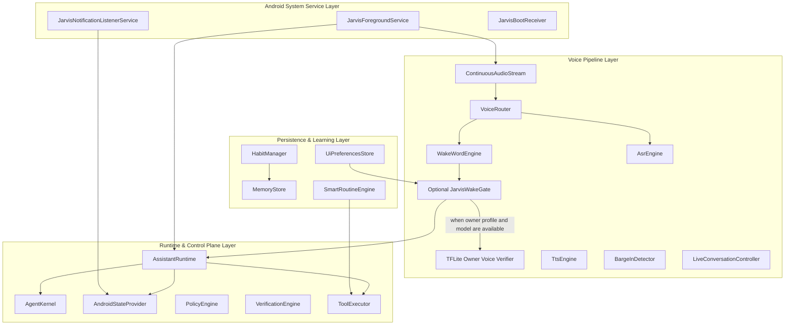

# J.A.R.V.I.S. Android Assistant Architecture

## Overview

J.A.R.V.I.S. is an autonomous AI assistant operating as an Android System Foreground Service. It combines real-time streaming voice interaction, multi-provider LLM orchestration, local RAG vector search, proactive device context monitoring, accessibility automation, and local routine learning.

---

## Component Deep Dive

### 1. Android Service & Core Lifecycle (`com.jarvis.service`)
- **`JarvisForegroundService`**: Core persistent Android foreground service maintaining active wake-word standby, voice pipeline instances, notification listeners, and LLM runtime. Interacts with `NotificationManager` to ensure persistent notification state.
- **`JarvisBootReceiver`**: Automatically initializes `JarvisForegroundService` on device boot (`ACTION_BOOT_COMPLETED`).

### 2. Real-Time Streaming Voice Pipeline (`com.jarvis.voice`)
- **`ContinuousAudioStream`**: Low-latency 16kHz PCM audio stream reader managing `AudioRecord` hardware, echo cancellation (AEC), noise suppression (NS), and hardware suspend/resume during voice enrollment or external audio capture.
- **`VoiceRouter`**: High-performance audio frame dispatcher that routes continuous PCM samples between `WakeWordEngine`, `BargeInDetector`, and `AsrEngine`.
- **`WakeWordEngine`**: The only production wake-word path. It receives audio from `ContinuousAudioStream`, keeps a one-second candidate buffer, and invokes the INT8 DS-CNN. The energy gate is separate from the manifest threshold; 2-of-3 temporal confirmation runs only inside the detector. Optional owner verification is disabled by default and fails closed when required but unavailable.
- **`VoiceEnrollmentDialog` / `WakeWordDatasetStore`**: Records 16 kHz mono PCM16 WAVs under app-private storage and exports the positive dataset. Enrollment updates dataset provenance only; offline `scripts/train_kws.py` performs actual optimization from positive, unknown, and background recordings.
- **Model availability**: `jarvis_model.json` and a matching real INT8 TFLite asset are required. If either is missing, invalid, or has a mismatched hash/tensor contract, wake detection reports unavailable; there is no heuristic or DTW fallback.
- **`AsrEngine` / `TtsEngine`**: Speech-to-text (Whisper / Android SpeechRecognizer) and Text-to-Speech (Groq TTS / Android TTS / PlayAI) modules.
- **`BargeInDetector` & `LiveConversationController`**: Sub-50ms full-duplex speech interruption detector and continuous turn-taking controller. Halts TTS playback when incoming human speech or interruption controls (`stop`, `mute`, `pause`) are detected.

### 3. Assistant Runtime & Agent Coordinator (`com.jarvis.runtime`, `com.jarvis.agent`)
- **`AssistantRuntime`**: Central coordinator holding subsystem references (`SubsystemManager`), memory engines, tool registries, and execution loops.
- **`AgentKernel`**: Intent classifier and task planner decomposing natural language queries into executable tool actions.
- **`AndroidStateProvider`**: Thread-safe device state model tracking battery, Wi-Fi, unread notifications, call states, active media, and the foreground app session (WhatsApp, Instagram, Chrome, Telegram, or YouTube). The session is refreshed from the accessibility service and is supplied to command routing.
- **Foreground app controls**: Contextual scroll and search requests use `APP_AUTOPILOT`; screen-reading requests use `SCREEN_VISION`. Foreground detection and in-app UI controls require Jarvis Accessibility Service to be enabled in Android settings. YouTube's dedicated playback tool remains available alongside shared UI controls.
- **`ToolExecutor` & `PolicyEngine`**: Safety policy enforcement engine and sandbox executor for system tools, messaging, device settings, and automation.

### 4. Notifications & Telecom Interception (`com.jarvis.notification`, `com.jarvis.earbuds`)
- **`JarvisNotificationListenerService`**: Android `NotificationListenerService` capturing active notifications (WhatsApp, SMS, system alerts) and updating `AndroidStateProvider`. Notifications are saved silently for explicit query ("read notifications").
- **`EarbudsAssistantEngine`**: Manages hands-free Bluetooth headset call screening and notification routing without forcing unprompted spoken TTS announcements.

### 5. Settings Persistence & UI (`com.jarvis.ui`)
- **`UiPreferencesStore`**: Encapsulates `SharedPreferences` for `AppSettings`, LLM provider keys, dataset/model provenance, and the optional owner speaker profile.
- **`SettingsScreen`**: User interface providing immediate persistence upon setting changes, hot-reloading configurations in `JarvisForegroundService` dynamically.

### 6. Local Routine Learning & Memory (`com.jarvis.habit`, `com.jarvis.memory`, `com.jarvis.routine`)
- **`HabitManager`**: Local privacy-focused habit miner capturing app usage, Wi-Fi network transitions, and charging events. Stored locally in `MemoryStore` under `LEARNED_PATTERN`.
- **`SmartRoutineEngine`**: Evaluates learned habit patterns and executes routines only when explicitly requested or confirmed by the user. Location data is never used.
