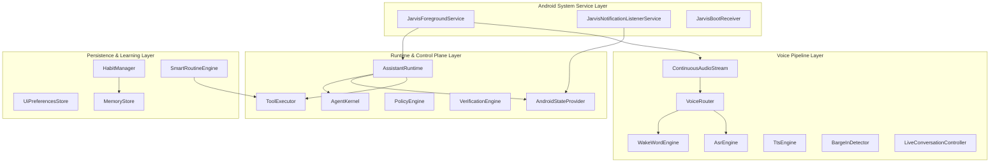

# J.A.R.V.I.S. Android Assistant Architecture

## Overview

J.A.R.V.I.S. is an autonomous AI assistant operating as an Android System Foreground Service. It combines real-time streaming voice interaction, multi-provider LLM orchestration, local RAG vector search, proactive device context monitoring, accessibility automation, and local routine learning.

---

## Component Deep Dive

### 1. Android Service & Core Lifecycle (`com.jarvis.service`)
- **`JarvisForegroundService`**: Core persistent Android foreground service maintaining active wake-word standby, voice pipeline instances, notification listeners, and LLM runtime. Interacts with `NotificationManager` to ensure persistent notification state.
- **`JarvisBootReceiver`**: Automatically initializes `JarvisForegroundService` on device boot (`ACTION_BOOT_COMPLETED`).

### 2. Real-Time Streaming Voice Pipeline (`com.jarvis.voice`)
- **`ContinuousAudioStream`**: Low-latency 16kHz PCM audio stream reader managing `AudioRecord` hardware, echo cancellation (AEC), noise suppression (NS), and hardware suspend/resume during voice enrollment or external audio capture.
- **`VoiceRouter`**: High-performance audio frame dispatcher that routes continuous PCM samples between `WakeWordEngine`, `BargeInDetector`, and `AsrEngine`.
- **`WakeWordEngine`**: Real-time wake-word engine running TFLite DS-CNN acoustic detection with user-specific voice calibration profiles (`UserVoiceProfile`).
- **`AsrEngine` / `TtsEngine`**: Speech-to-text (Whisper / Android SpeechRecognizer) and Text-to-Speech (Groq TTS / Android TTS / PlayAI) modules.
- **`BargeInDetector` & `LiveConversationController`**: Sub-50ms full-duplex speech interruption detector and continuous turn-taking controller. Halts TTS playback when incoming human speech or interruption controls (`stop`, `mute`, `pause`) are detected.

### 3. Assistant Runtime & Agent Coordinator (`com.jarvis.runtime`, `com.jarvis.agent`)
- **`AssistantRuntime`**: Central coordinator holding subsystem references (`SubsystemManager`), memory engines, tool registries, and execution loops.
- **`AgentKernel`**: Intent classifier and task planner decomposing natural language queries into executable tool actions.
- **`AndroidStateProvider`**: Thread-safe reactive state model tracking device state (battery, Wi-Fi, unread notifications, call states, active media).
- **`ToolExecutor` & `PolicyEngine`**: Safety policy enforcement engine and sandbox executor for system tools, messaging, device settings, and automation.

### 4. Notifications & Telecom Interception (`com.jarvis.notification`, `com.jarvis.earbuds`)
- **`JarvisNotificationListenerService`**: Android `NotificationListenerService` capturing active notifications (WhatsApp, SMS, system alerts) and updating `AndroidStateProvider`. Notifications are saved silently for explicit query ("read notifications").
- **`EarbudsAssistantEngine`**: Manages hands-free Bluetooth headset call screening and notification routing without forcing unprompted spoken TTS announcements.

### 5. Settings Persistence & UI (`com.jarvis.ui`)
- **`UiPreferencesStore`**: Encapsulates `SharedPreferences` for `AppSettings`, LLM provider keys, custom voice profiles, and system configurations.
- **`SettingsScreen`**: User interface providing immediate persistence upon setting changes, hot-reloading configurations in `JarvisForegroundService` dynamically.

### 6. Local Routine Learning & Memory (`com.jarvis.habit`, `com.jarvis.memory`, `com.jarvis.routine`)
- **`HabitManager`**: Local privacy-focused habit miner capturing app usage, Wi-Fi network transitions, and charging events. Stored locally in `MemoryStore` under `LEARNED_PATTERN`.
- **`SmartRoutineEngine`**: Evaluates learned habit patterns and executes routines only when explicitly requested or confirmed by the user. Location data is never used.
