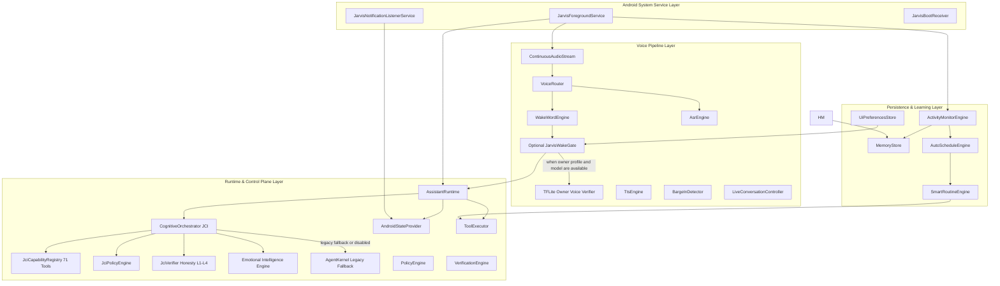

# J.A.R.V.I.S. Android Assistant Architecture

## Overview

J.A.R.V.I.S. is an Android assistant operating through a foreground service. It combines streaming voice interaction, multi-provider LLM orchestration, SQLite memory and document retrieval, device context monitoring, accessibility automation, and local routines. The main `MemoryStore` uses FTS4 and lexical/recency ranking. The separate document RAG retriever combines BM25, lexical cosine, and optional deterministic character n-gram cosine; the latter is not semantic language-model embedding.

---

## Component Deep Dive

### 1. Android Service & Core Lifecycle (`com.jarvis.service`)
- **`JarvisForegroundService`**: Core persistent Android foreground service maintaining active wake-word standby, voice pipeline instances, notification listeners, and LLM runtime. Interacts with `NotificationManager` to ensure persistent notification state.
- **`JarvisBootReceiver`**: Automatically initializes `JarvisForegroundService` on device boot (`ACTION_BOOT_COMPLETED`).

### 2. Real-Time Streaming Voice Pipeline (`com.jarvis.voice`)
- **`ContinuousAudioStream`**: Low-latency 16kHz PCM audio stream reader managing `AudioRecord` hardware, echo cancellation (AEC), noise suppression (NS), and hardware suspend/resume during voice enrollment or external audio capture.
- The capture loop backs off on zero-length reads, retries recoverable hardware failures, and clears its running state after unrecoverable errors so it can be restarted.
- **`VoiceRouter`**: High-performance audio frame dispatcher that routes continuous PCM samples between `WakeWordEngine`, `BargeInDetector`, and `AsrEngine`.
- **`WakeWordEngine`**: The only production wake-word path. It receives audio from `ContinuousAudioStream`, feeds openWakeWord shared frontend feature models (`melspectrogram.tflite`, `embedding_model.tflite`), and invokes the classifier heads (`hey_jarvis_v0.1.tflite` and optional `jarvis_openwakeword.tflite`). The energy gate is separate from the manifest threshold; 2-of-3 temporal confirmation runs inside the detector. Optional owner verification is disabled by default and fails closed when required but unavailable.
- **`VoiceEnrollmentDialog` / `WakeWordDatasetStore`**: Records 16 kHz mono PCM16 WAVs under app-private storage and exports the positive dataset. Enrollment updates dataset provenance only; offline openWakeWord training performs actual weight optimization from positive, unknown, and background recordings.
- **Model availability**: `openwakeword_models.json` and matching TFLite feature and classifier assets are required. If any asset is missing, invalid, or has a mismatched SHA-256 hash/tensor contract, wake detection reports unavailable; there is no heuristic or DTW fallback.
- **`AsrEngine` / `TtsEngine`**: Speech-to-text (Whisper / Android SpeechRecognizer) and Text-to-Speech (Groq TTS / Android TTS / PlayAI) modules.
- **`BargeInDetector` & `LiveConversationController`**: Sub-50ms full-duplex speech interruption detector and continuous turn-taking controller. Halts TTS playback when incoming human speech or interruption controls (`stop`, `mute`, `pause`) are detected.

### 3. Assistant Runtime & Agent Coordinator (`com.jarvis.runtime`, `com.jarvis.agent`)
- **`AssistantRuntime`**: Central coordinator holding subsystem references (`SubsystemManager`), memory engines, tool registries, and execution loops.
- **`AgentKernel`**: Intent classifier and task planner decomposing natural language queries into executable tool actions.
- **`AndroidStateProvider`**: Thread-safe device state model tracking battery, Wi-Fi, unread notifications, call states, active media, and the foreground app session (WhatsApp, Instagram, Chrome, Telegram, or YouTube). The session is refreshed from the accessibility service and is supplied to command routing.
- **Foreground app controls**: Contextual scroll and search requests use `APP_AUTOPILOT`; screen-reading requests use `SCREEN_VISION`. Foreground detection and in-app UI controls require Jarvis Accessibility Service to be enabled in Android settings. YouTube's dedicated playback tool remains available alongside shared UI controls.
- **`ToolExecutor` & `PolicyEngine`**: Safety policy enforcement engine and sandbox executor for system tools, messaging, device settings, and automation.

### 4. Notifications & Telecom Interception (`com.jarvis.notification`, `com.jarvis.earbuds`)
- **`JarvisNotificationListenerService`**: Android `NotificationListenerService` capturing active notifications (WhatsApp, SMS, system alerts) and updating `AndroidStateProvider`. Notifications are saved silently for explicit query ("read notifications").
- **`EarbudsAssistantEngine`**: Manages hands-free Bluetooth headset call screening and notification routing without forcing unprompted spoken TTS announcements.

### 5. Settings Persistence & UI (`com.jarvis.ui`)
- **`UiPreferencesStore`**: Encapsulates `SharedPreferences` for `AppSettings`, LLM provider keys, dataset/model provenance, and the optional owner speaker profile.
- **`SettingsScreen`**: User interface providing immediate persistence upon setting changes, hot-reloading configurations in `JarvisForegroundService` dynamically.

### 6. Local Routine Learning & Memory (`com.jarvis.habit`, `com.jarvis.memory`, `com.jarvis.routine`)
- **`HabitManager`**: Local privacy-focused habit miner capturing app usage, Wi-Fi network transitions, and charging events. Stored locally in `MemoryStore` under `LEARNED_PATTERN`.
- **`SmartRoutineEngine`**: Evaluates learned habit patterns and executes routines only when explicitly requested or confirmed by the user. Location data is never used.
- **`MemoryStore`**: SQLite FTS4 keyword candidates ranked by lexical overlap, importance, recency, and access count. TTL-expired rows and their FTS entries are purged before memory reads.
- **Session summaries**: When an LLM client is configured, a bounded session transcript may be summarized asynchronously and stored as a conversation task artifact. Empty or `NONE` summaries are ignored.

### 7. LAN and wearable entry points
- **`JarvisLanServer`**: Serves packaged web assets as raw bytes and accepts UTF-8 API bodies using byte-based content lengths, with API authentication and a bounded request size.
- **`WearableCompanionReceiver`**: Wake and command broadcasts preserve their action when starting a cold foreground service; stop is handled only when the service is already active.

### 8. Emotional Intelligence Engine (`com.jarvis.emotion`)
- **`DeterministicSentimentAnalyzer`**: Pure, deterministic lexical analysis evaluating incoming utterance valence, arousal, and sentiment polarity without remote API dependence.
- **`EmotionalStateReducer`**: Finite state reducer managing seven distinct emotional modes (`CALM`, `FOCUSED`, `EMPATHETIC`, `ALERT`, `CONFUSED`, `WITTY`, `CELEBRATORY`) with temporal decay dynamics and user feedback updates.
- **`ResponseStylePolicyEngine`**: Dynamically maps affective state into conversational tone, prompt instructions, and conciseness guidelines.
- **`VoiceProfileAdapter` & `JarvisOrbView`**: Modulates speech synthesizer parameters (pitch, speed, volume inflection) and transitions holographic Orb core color, pulsing frequency, and particle dispersion with reduced-motion accessibility options.
- **`EmotionalJsonContract`**: Validated JSON serialization/deserialization for persisting affective state across process lifecycles.

### 9. Jarvis Cognitive Core — JCI (`com.jarvis.cognitive`)
- **`CognitiveOrchestrator`**: Master choke-point interceptor at `AssistantRuntime.executeCommand`. Operates across four cognitive modes:
  - `DIRECT`: Sub-millisecond deterministic execution for single-step device controls.
  - `PLAN`: Multi-step dependency graph planning and phased execution.
  - `CLARIFY`: Structured ambiguity resolution and confirmation requests.
  - `REFUSE`: Immediate, polite rejection for destructive, unsafe, or policy-violating commands.
  - Supports non-intrusive shadow mode (`JCI_SHADOW`) and transparent fail-safe fallback to legacy pipelines.
- **`JciCapabilityRegistry`**: Strongly typed catalog of 71 audited canonical capabilities complete with input/output JSON schemas, risk tiers (`READ_ONLY`, `LOW`, `MEDIUM`, `HIGH`, `CRITICAL`), and multilingual aliases.
- **`JciPolicyEngine` & `JciVerifier`**: Zero-trust execution gate enforcing safety constraints. Features four-tier honesty verification (`L1_LOCAL_READ`, `L2_OS_CONFIRMED`, `L3_SYNTHETIC_OBSERVED`, `L4_DISPATCHED_ONLY`) forbidding unverified completion claims.
- **`JciPlanner` & `JciPlanExecutor`**: Graph-based task planner managing sequential dependencies, parallel operations, intermediate verification checkpoints, and automatic rollbacks on failures.
- **`JciMemoryManager`**: Local multi-tier memory maintaining session working context, epistemic capability state, and episodic execution logs with PII redaction.
- **`JciStyleFormatter` & `JciProactiveEngine`**: Dry, concise MCU-Jarvis persona generation and scheduled proactive triggers enforcing quiet-hours suppression (22:00–08:00) with rate-limiting.
