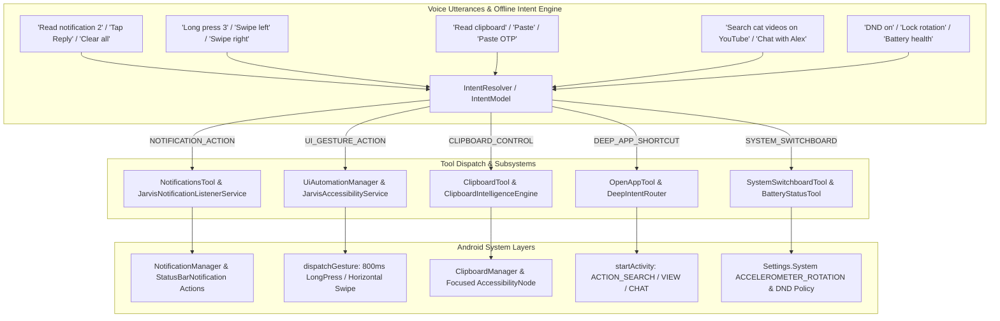

# Implementation Plan: Hands-Free Full Control (Phase 4)

Phase 4 elevates hands-free device operation to desktop-class capability: interactive notification actions and dismissals, touchless long-press and directional swipes, voice clipboard inspection and direct OTP field injection, deep in-app search/chat navigation, and hardware toggles for Do Not Disturb (DND), mobile hotspot, screen rotation lock, and battery diagnostics.

---

## User Review Required

> [!IMPORTANT]
> **Android Permissions Context:**
> 1. **Do Not Disturb (DND):** Changing DND requires Android Notification Policy Access (`android.permission.ACCESS_NOTIFICATION_POLICY`). If not granted, Jarvis gracefully prompts the user and opens the system settings panel.
> 2. **Screen Auto-Rotation:** Modifying `Settings.System.ACCELEROMETER_ROTATION` requires `Settings.System.canWrite(context)` (Write Settings permission). If blocked, Jarvis directs the user to grant permission.
> 3. **Notification Actions:** Triggering `Notification.Action` pending intents uses `JarvisNotificationListenerService` which already holds Notification Access.

---

## Architecture Overview



---

## Proposed Changes

### Component 1: Interactive Notification Actions & Dismissal
Enhance `NotificationsTool.kt` and `JarvisNotificationListenerService.kt` to allow reading specific notifications by number, executing their embedded `Notification.Action`s hands-free, and clearing/dismissing notifications.

#### [MODIFY] [`app/src/main/java/com/jarvis/notification/JarvisNotificationListenerService.kt`](file:///home/shanu/Pictures/android-jarvis-main/app/src/main/java/com/jarvis/notification/JarvisNotificationListenerService.kt)
- Add `getActiveStatusBarNotifications(): Array<StatusBarNotification>` getter.
- Add `triggerNotificationAction(index: Int, actionQuery: String?): Boolean`:
  - Locates the active notification at `index` (1-based).
  - Finds matching `Notification.Action` by title or clicks the first action (e.g., "Reply", "Mark as read", "Archive").
  - Dispatches `action.actionIntent.send()`.
- Add `dismissNotification(index: Int): Boolean` and `dismissAllNotifications(): Boolean` via `cancelAllNotifications()`.

#### [MODIFY] [`app/src/main/java/com/jarvis/tools/NotificationsTool.kt`](file:///home/shanu/Pictures/android-jarvis-main/app/src/main/java/com/jarvis/tools/NotificationsTool.kt)
- Add actions `'read_item'` (with `index`), `'trigger_action'` (with `index` and `action_title`), and `'dismiss_all'`.
- Provide clean spoken confirmation for each action.

#### [MODIFY] [`app/src/main/java/com/jarvis/ai/IntentModel.kt`](file:///home/shanu/Pictures/android-jarvis-main/app/src/main/java/com/jarvis/ai/IntentModel.kt)
- Add `AssistantIntent.NOTIFICATION_INTERACTION` fast-paths:
  - `"read notification 1"`, `"check notification 2"`, `"second notification"`
  - `"reply to notification 1"`, `"tap action on notification 2"`
  - `"clear all notifications"`, `"dismiss notifications"`, `"clear notification shade"`

---

### Component 2: Touchless Long-Press & Directional Swipes
Add long-press gestures and horizontal swipes to `JarvisAccessibilityService.kt` and expose them via `UiAutomationManager.kt`.

#### [MODIFY] [`app/src/main/java/com/jarvis/accessibility/JarvisAccessibilityService.kt`](file:///home/shanu/Pictures/android-jarvis-main/app/src/main/java/com/jarvis/accessibility/JarvisAccessibilityService.kt)
- Add `longClickCoordinates(x: Float, y: Float, durationMs: Long = 800): Boolean`:
  - Dispatches `GestureDescription` with 800ms dwell time at coordinates.
- Add `swipeHorizontal(direction: String): Boolean`:
  - For `"left"`: swiping from 80% screen width to 20% screen width (next page / next tab).
  - For `"right"`: swiping from 20% screen width to 80% screen width (previous page / open drawer).

#### [MODIFY] [`app/src/main/java/com/jarvis/accessibility/UiAutomationManager.kt`](file:///home/shanu/Pictures/android-jarvis-main/app/src/main/java/com/jarvis/accessibility/UiAutomationManager.kt)
- Add `longClick(query: String)`: searches by text, badge number, or viewId, finds center coordinates, and dispatches `longClickCoordinates`.
- Add `swipeHorizontal(direction: String)`.

#### [MODIFY] [`app/src/main/java/com/jarvis/ai/IntentModel.kt`](file:///home/shanu/Pictures/android-jarvis-main/app/src/main/java/com/jarvis/ai/IntentModel.kt)
- Fast-paths under `AssistantIntent.UI_GESTURE_ACTION`:
  - `"long press <target>"`, `"long click <target>"`, `"hold <target>"`, `"hold item 3"`, `"long press badge 2"`
  - `"swipe left"`, `"swipe right"`, `"next tab"`, `"previous tab"`, `"swipe next"`

---

### Component 3: Hands-Free Voice Clipboard & OTP Injection
Create `ClipboardTool.kt` to inspect clipboard text aloud, copy text, paste clipboard text into the active focused field, and paste the latest verified SMS OTP directly.

#### [NEW] [`app/src/main/java/com/jarvis/tools/ClipboardTool.kt`](file:///home/shanu/Pictures/android-jarvis-main/app/src/main/java/com/jarvis/tools/ClipboardTool.kt)
- Registered as `CLIPBOARD_CONTROL` with actions:
  - `'read'`: Retrieves primary clip text and speaks it aloud.
  - `'copy'`: Writes parameter `text` to system clipboard.
  - `'paste'`: Injects system clipboard text into active input field via `JarvisAccessibilityService.injectTextIntoFocusedInput()`.
  - `'paste_otp'`: Queries `CallAndSmsAgent.instance?.readRecentSms(1, otpOnly=true)` and injects the extracted OTP code into the focused field.

#### [MODIFY] [`app/src/main/java/com/jarvis/runtime/AssistantRuntime.kt`](file:///home/shanu/Pictures/android-jarvis-main/app/src/main/java/com/jarvis/runtime/AssistantRuntime.kt)
- Register `ClipboardTool` in `toolRegistry`.

#### [MODIFY] [`app/src/main/java/com/jarvis/ai/IntentModel.kt`](file:///home/shanu/Pictures/android-jarvis-main/app/src/main/java/com/jarvis/ai/IntentModel.kt)
- Add `AssistantIntent.CLIPBOARD_CONTROL`:
  - `"read clipboard"`, `"what is copied"`, `"check clipboard"`
  - `"copy <text>"`, `"copy this text"`
  - `"paste"`, `"paste text"`, `"paste clipboard"`
  - `"paste otp"`, `"enter otp"`, `"fill otp"`

---

### Component 4: Deep App Search & Intent Shortcuts
Expand `OpenAppTool.kt` to handle in-app searches and direct activity shortcuts instead of only launching app root screens.

#### [MODIFY] [`app/src/main/java/com/jarvis/tools/OpenAppTool.kt`](file:///home/shanu/Pictures/android-jarvis-main/app/src/main/java/com/jarvis/tools/OpenAppTool.kt)
- Add parameter `query: String` and `action: String`.
- Support:
  - YouTube search: `Intent(Intent.ACTION_SEARCH).setPackage("com.google.android.youtube").putExtra("query", query)`
  - Web search / Chrome: `Intent(Intent.ACTION_WEB_SEARCH).putExtra(SearchManager.QUERY, query)`
  - Spotify search: `Intent(MediaStore.INTENT_ACTION_MEDIA_PLAY_FROM_SEARCH).putExtra(SearchManager.QUERY, query)`
  - WhatsApp direct chat: `Intent(Intent.ACTION_VIEW, Uri.parse("https://api.whatsapp.com/send?phone=$number"))` or accessibility fallback.

#### [MODIFY] [`app/src/main/java/com/jarvis/ai/IntentModel.kt`](file:///home/shanu/Pictures/android-jarvis-main/app/src/main/java/com/jarvis/ai/IntentModel.kt)
- Add matchers:
  - `"search <query> on youtube"`, `"youtube search <query>"`
  - `"search <query> on chrome"`, `"google search <query>"`
  - `"search <query> on spotify"`

---

### Component 5: Hardware Switchboard & DND / Hotspot / Auto-Rotate Toggles
Add Do Not Disturb (DND), Mobile Hotspot settings, Screen Auto-Rotation lock, and Battery health diagnostics to `SystemSwitchboardTool.kt` and `BatteryStatusTool.kt`.

#### [MODIFY] [`app/src/main/java/com/jarvis/tools/SystemSwitchboardTool.kt`](file:///home/shanu/Pictures/android-jarvis-main/app/src/main/java/com/jarvis/tools/SystemSwitchboardTool.kt)
- Add action `'auto_rotate'` / `'rotation'`:
  - Checks Write Settings permission.
  - Toggles `Settings.System.putInt(contentResolver, Settings.System.ACCELEROMETER_ROTATION, if (on) 1 else 0)`.
- Connect DND and Hotspot actions seamlessly with voice triggers.

#### [MODIFY] [`app/src/main/java/com/jarvis/tools/BatteryStatusTool.kt`](file:///home/shanu/Pictures/android-jarvis-main/app/src/main/java/com/jarvis/tools/BatteryStatusTool.kt)
- Expose battery health, temperature, voltage, and charging technology (Fast / Wireless / USB) in spoken report.

#### [MODIFY] [`app/src/main/java/com/jarvis/ai/IntentModel.kt`](file:///home/shanu/Pictures/android-jarvis-main/app/src/main/java/com/jarvis/ai/IntentModel.kt)
- Add fast-paths:
  - `"turn on do not disturb"`, `"dnd on"`, `"turn off dnd"`, `"dnd off"`
  - `"turn on hotspot"`, `"hotspot on"`, `"turn off hotspot"`, `"hotspot off"`
  - `"lock screen rotation"`, `"unlock rotation"`, `"turn on auto rotate"`, `"turn off auto rotate"`
  - `"battery health"`, `"battery report"`, `"battery details"`

---

## Verification Plan

### Automated Tests
Execute targeted tests via Gradle using JDK 17:
```bash
JAVA_HOME=/home/shanu/jdk/jdk-17.0.13+11 ./gradlew testDebugUnitTest --tests com.jarvis.tools.NotificationInteractionTest
JAVA_HOME=/home/shanu/jdk/jdk-17.0.13+11 ./gradlew testDebugUnitTest --tests com.jarvis.tools.TouchlessGesturesTest
JAVA_HOME=/home/shanu/jdk/jdk-17.0.13+11 ./gradlew testDebugUnitTest --tests com.jarvis.tools.ClipboardToolTest
JAVA_HOME=/home/shanu/jdk/jdk-17.0.13+11 ./gradlew testDebugUnitTest --tests com.jarvis.tools.DeepAppShortcutsTest
JAVA_HOME=/home/shanu/jdk/jdk-17.0.13+11 ./gradlew testDebugUnitTest --tests com.jarvis.tools.HardwareSwitchboardPhase4Test
```

Full regression test suite:
```bash
JAVA_HOME=/home/shanu/jdk/jdk-17.0.13+11 ./gradlew testDebugUnitTest
```

### Manual Verification
1. **Interactive Notifications:** Announce incoming WhatsApp notification, speak *"Reply to notification 1"* or *"Clear all notifications"*.
2. **Touchless Gestures:** On home screen, speak *"Hold item 3"* or *"Swipe left"* to verify pager navigation.
3. **Clipboard & OTP:** Copy a test code, focus an input field, speak *"Paste OTP"* or *"Paste clipboard"*.
4. **App Shortcuts:** Speak *"Search interstellar theme on YouTube"* and verify direct search results playback.
5. **Hardware Toggles:** Speak *"Turn on Do Not Disturb"*, *"Lock screen rotation"*, and *"Battery health"*.
