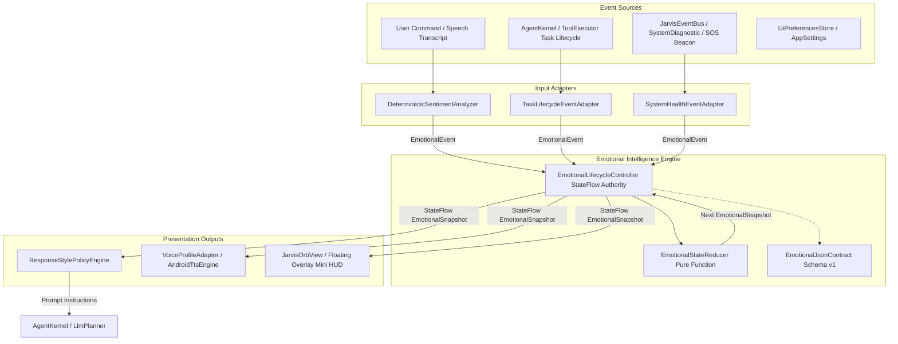

# Jarvis Emotional Intelligence Engine Implementation Plan

> **For agentic workers:** REQUIRED SUB-SKILL: Use superpowers:subagent-driven-development (recommended) or superpowers:executing-plans to implement this plan task-by-task. Steps use checkbox (`- [ ]`) syntax for tracking.

**Goal:** Implement a production-oriented, modular, event-driven emotional intelligence engine for Android that reproduces the recognizable MCU J.A.R.V.I.S. communication characteristics across six distinct states (`HAPPY`, `SAD`, `KIDDING`, `PANIC`, `THINKING`, `FOCUSED`), tightly integrated with existing task managers, NLU, LLM prompts, Android TTS, and the floating orb UI.

**Architecture:** A single authoritative pure reducer (`EmotionalStateReducer`) processes typed `EmotionalEvent`s into immutable `EmotionalSnapshot`s, arbitrated by a lifecycle controller (`EmotionalLifecycleController`) with generation-based stale callback rejection and cancellable coroutine expiry. The resulting state drives `ResponseStylePolicy` into the LLM/conversational layer, voice rate/pitch adaptation into `TtsEngine`, and visual styling into `JarvisOrbView` and `JarvisFloatingOverlayService`.

**Tech Stack:** Kotlin 1.9, Kotlinx Coroutines 1.10.1 (`StateFlow`, `SupervisorJob`), Android SDK 28–35 (Java 17 jvmTarget), Android TTS (`TextToSpeech`, `UtteranceProgressListener`), JUnit 4 test runner.

**Spec:** User Master Implementation Prompt: Jarvis Emotional Intelligence Engine for Android.

---

## Global Constraints

- **Single Authoritative State Reducer:** Deterministic pure reducer without side effects; core decision logic independent of Android framework classes for pure JVM testability.
- **State Precedence Order:** `PANIC` (validated critical risk) > `THINKING` (active task pending) > `SAD` (high-confidence support request) > `HAPPY` (verified task success) > `KIDDING` (explicit/safe humor) > `FOCUSED` (default baseline).
- **Task Failure != Panic:** Ordinary tool or task failures produce `FOCUSED` with truthful diagnostic messaging, never `PANIC`.
- **No LLM State Mutation:** Generative model output never overwrites authoritative emotional state; LLM receives response style instructions, not state write access.
- **Resource & Battery Preservation:** Strictly event-driven; no polling loops, no dedicated background recording service, no heavy local neural network for sentiment, no persistent disk writes on state transitions.
- **TTS Serialization:** Voice profile mutations (speech rate and pitch) are synchronized with utterance synthesis to prevent cross-talk or race conditions.
- **Preserve Existing Assistant Capabilities:** Wake word, speech recognizer, intent router, tools, and background service lifecycles remain completely intact.

---

## Review Focus

1. **Stale Expiry & Task Completion Rejection:** Expiry callbacks or completed task events from prior operations must be discarded via monotonic generation tracking so they cannot overwrite newer active tasks.
2. **PANIC Persistence:** Active critical conditions (`EmergencySosBeaconEngine`, overheating, critical battery hazard) cannot be cleared by unrelated events (such as speech recognition or task completions); only explicit validated recovery clears `PANIC`.
3. **Task Success Verification:** `HAPPY` state triggers only when `taskPhase == SUCCEEDED` with `verified == true` (confirmed outcome), never on speculative dispatch or initial LLM intent prediction.
4. **Humor Gating & Emergency Suppression:** `KIDDING` is strictly suppressed whenever an active hazard, serious disclosure, or `humorEnabled == false` preference is present.
5. **TTS Audio Focus & Interruption Safety:** A transition to `PANIC` immediately interrupts lower-priority ongoing speech and synthesizes the critical warning without throwing unhandled audio focus exceptions.

---

## Architecture Diagram



---

## Proposed Changes

### Component 1: Core Models & JSON State Contract (Package `com.jarvis.emotion`)

#### [NEW] `app/src/main/java/com/jarvis/emotion/EmotionalModels.kt`
Defines all strongly typed domain models:
- `AssistantState`: `HAPPY`, `SAD`, `KIDDING`, `PANIC`, `THINKING`, `FOCUSED`.
- `TaskPhase`: `IDLE`, `PROCESSING`, `WAITING_FOR_TOOL`, `SUCCEEDED`, `FAILED`, `CANCELLED`.
- `Sentiment`: `POSITIVE`, `NEGATIVE`, `NEUTRAL`, `UNKNOWN`.
- `SignalSource`: `USER_EXPLICIT`, `NLU`, `TASK_MANAGER`, `SYSTEM_HEALTH`, `USER_PREFERENCE`.
- `EmotionalEvent`: Event carrying ID, operation ID, timestamp, sentiment, confidence, signals (support, humor, serious context, critical risk, risk recovery), and task phase.
- `EmotionalSnapshot`: Immutable state container with state, previousState, reason, confidence, priority, timestamps, operationId, generation, context, and presentation profiles.
- `VoiceProfile`: Encapsulates speech rate, pitch, audio focus usage, and interruptibility.
- `UiEmotionProfile`: Encapsulates primary/secondary glow colors, pulse period, and accessible label.
- `ResponseStyle`: Instructions for LLM prompt generation (conciseness, humor allowed, empathy level, urgency).

#### [NEW] `app/src/main/java/com/jarvis/emotion/EmotionalJsonContract.kt`
Implements the exact JSON Schema v1 contract specified in Section 8:
- Dynamic runtime session ID, version number, enteredAtMs, operationId, presentation profiles.
- Safe serialization and deserialization with null-safety and validation checks.

---

### Component 2: Pure State Reducer & Deterministic Sentiment Analyzer

#### [NEW] `app/src/main/java/com/jarvis/emotion/EmotionalStateReducer.kt`
- Implements `reduce(current: EmotionalSnapshot, event: EmotionalEvent, preferences: EmotionalPreferences): EmotionalSnapshot`.
- Strict priority ordering:
  1. Active critical risk (`isCriticalRisk == true` or current state `PANIC` and `isRiskResolved != true`) -> `PANIC` (Priority 100).
  2. Active task pending (`taskPhase in [PROCESSING, WAITING_FOR_TOOL]`) -> `THINKING` (Priority 80).
  3. High-confidence support context (`supportRecommended == true`, `confidence >= threshold`, not serious/critical) -> `SAD` (Priority 60).
  4. Verified task success (`taskPhase == SUCCEEDED && verified == true`) -> `HAPPY` (Priority 50).
  5. Harmless humor (`humorRecommended == true && humorAllowed == true`) -> `KIDDING` (Priority 40).
  6. Default -> `FOCUSED` (Priority 10).
- Calculates expiration timestamps: 4000ms for `HAPPY`, 6000ms for `SAD`, 4000ms for `KIDDING`, `null` for `PANIC`, `THINKING`, `FOCUSED`.

#### [NEW] `app/src/main/java/com/jarvis/emotion/DeterministicSentimentAnalyzer.kt`
- Deterministic, zero-allocation rules analyzer recognizing explicit support requests, gratitude/positive news, playful/joke requests, and serious/critical terminology.
- Calculates confidence scores, flags ambiguous text as `Sentiment.UNKNOWN`, and rejects emergency inferences from sentiment alone.

---

### Component 3: Lifecycle Controller & Response Style Policy

#### [NEW] `app/src/main/java/com/jarvis/emotion/EmotionalLifecycleController.kt`
- StateFlow publisher (`snapshot: StateFlow<EmotionalSnapshot>`).
- Thread-safe serialized state processing via atomic references or mutex.
- Monotonic generation counter: increments on every transition; schedules cancellable coroutine timer for transient states (`HAPPY`, `SAD`, `KIDDING`).
- Stale expiry guard: When timer expires, checks if current generation matches. If matched, returns to underlying state (`FOCUSED` or `THINKING` if active task remains).
- Stale task guard: Events with outdated operation IDs are ignored.

#### [NEW] `app/src/main/java/com/jarvis/emotion/ResponseStylePolicyEngine.kt`
- Translates `EmotionalSnapshot` into system prompt directives for MCU J.A.R.V.I.S.:
  - `FOCUSED`: "Answer concisely in 1-2 professional sentences. Direct action first."
  - `HAPPY`: "Acknowledge successful verified completion with calm, warm satisfaction. Avoid hyperbole."
  - `SAD`: "Provide supportive, calm empathy. Acknowledge difficulty without forced cheerfulness or unsolicited humor."
  - `KIDDING`: "Deliver a single dry, restrained humorous observation, then immediately complete the task."
  - `PANIC`: "Urgent and direct. State the critical warning and immediate safe action first. No preamble."
  - `THINKING`: "State that work is actively in progress."

---

### Component 4: TTS & UI Adaptation

#### [NEW] `app/src/main/java/com/jarvis/emotion/VoiceProfileAdapter.kt`
- Maps `AssistantState` to speech rate and pitch:
  - `HAPPY`: rate 1.04, pitch 1.03
  - `SAD`: rate 0.94, pitch 0.97
  - `KIDDING`: rate 1.02, pitch 1.02
  - `PANIC`: rate 1.04, pitch 1.01
  - `THINKING`: rate 0.98, pitch 1.00
  - `FOCUSED`: rate 1.00, pitch 1.00
- Adapts `TtsEngine` dynamically before speech synthesis.

#### [MODIFY] `app/src/main/java/com/jarvis/voice/TtsEngine.kt` & `app/src/main/java/com/jarvis/voice/AndroidTtsEngine.kt`
- Add `fun applyVoiceProfile(rate: Float, pitch: Float)` to `TtsEngine` with default empty impl.
- In `AndroidTtsEngine`, update `setSpeechRate` and `setPitch` safely with thread-safe caching.

#### [MODIFY] `app/src/main/java/com/jarvis/ui/JarvisOrbView.kt`
- Add `setAssistantEmotion(state: AssistantState)` and `setEmotionProfile(profile: UiEmotionProfile)`.
- Configures distinct arc reactor primary/secondary glow colors and animation pulse rates per state.
- Respects `reducedMotionEnabled` (disables fast rotation/pulsing, preserves color and static state).
- Updates accessible `contentDescription` for screen readers (e.g., "Jarvis state: Critical Warning Alert").

#### [MODIFY] `app/src/main/java/com/jarvis/ui/model/UiModels.kt` & `app/src/main/java/com/jarvis/ui/data/UiPreferencesStore.kt`
- Add emotional preferences to `AppSettings`:
  - `emotionalPresentationEnabled: Boolean = true`
  - `humorEnabled: Boolean = true`
  - `voiceExpressionEnabled: Boolean = true`
  - `uiEmotionAnimationsEnabled: Boolean = true`
  - `sentimentConfidenceThreshold: Float = 0.65f`
  - `reducedMotionEnabled: Boolean = false`
- Persist in `UiPreferencesStore` JSON serializer/deserializer.

---

### Component 5: Runtime Task Lifecycle & Event Bus Integration

#### [NEW] `app/src/main/java/com/jarvis/emotion/EmotionalIntegrationAdapter.kt`
- Observes `JarvisEventBus` events:
  - `SystemAlert("CRITICAL", ...)` or `EmergencySosBeaconEngine` triggers -> dispatches `PANIC`.
  - Recovery alerts -> dispatches `riskResolved = true`.
- Exposes task hooks for `AssistantRuntime` and `AgentKernel`:
  - `onTaskStarted(taskId, goal)` -> dispatches `TaskPhase.PROCESSING`.
  - `onToolStarted(taskId, toolName)` -> dispatches `TaskPhase.WAITING_FOR_TOOL`.
  - `onTaskCompleted(taskId, verified, message)` -> dispatches `TaskPhase.SUCCEEDED` (if verified) or `TaskPhase.FAILED`.
  - `onTaskCancelled(taskId)` -> dispatches `TaskPhase.CANCELLED`.
  - `onUserInput(utterance)` -> analyzes sentiment and dispatches contextual event.

#### [MODIFY] `app/src/main/java/com/jarvis/runtime/AssistantRuntime.kt`
- Instantiates `EmotionalLifecycleController` and `EmotionalIntegrationAdapter`.
- Wires task execution and `AgentKernel.run()` events (`TaskStarted`, `Thinking`, `Completed`, `Failed`, `Cancelled`) into the emotional controller.
- Passes active `ResponseStyle` instructions into prompt generation.

#### [MODIFY] `app/src/main/java/com/jarvis/voice/VoiceEngine.kt`
- Connects speech pipeline to `VoiceProfileAdapter` so speech synthesis uses active pitch/rate.
- Immediately stops/interrupts speech when `PANIC` is triggered.

#### [MODIFY] `app/src/main/java/com/jarvis/overlay/JarvisFloatingOverlayService.kt`
- Observes `EmotionalLifecycleController.snapshot` flow and updates `JarvisOrbView` and HUD status text.

---

## Detailed Task Breakdown

### Task 1: Core Models, Data Structures & JSON State Contract v1

**Files:**
- Create: `app/src/main/java/com/jarvis/emotion/EmotionalModels.kt`
- Create: `app/src/main/java/com/jarvis/emotion/EmotionalJsonContract.kt`
- Test: `app/src/test/java/com/jarvis/emotion/EmotionalJsonContractTest.kt`

**Interfaces:**
- Consumes: Standard Kotlin/Java standard library, `org.json.JSONObject`.
- Produces: `AssistantState`, `TaskPhase`, `Sentiment`, `SignalSource`, `EmotionalEvent`, `EmotionalSnapshot`, `VoiceProfile`, `UiEmotionProfile`, `ResponseStyle`, `EmotionalPreferences`, `EmotionalJsonContract`.

- [ ] **Step 1: Write the failing test**
  Create `EmotionalJsonContractTest.kt` testing serialization of all 6 states (`HAPPY`, `SAD`, `KIDDING`, `PANIC`, `THINKING`, `FOCUSED`), verifying schemaVersion=1, operationId preservation, nullability handling, and JSON round-trip deserialization.
- [ ] **Step 2: Run test to verify it fails**
  `env JAVA_HOME=/home/shanu/jdk/jdk-17.0.13+11 ./gradlew testDebugUnitTest --tests com.jarvis.emotion.EmotionalJsonContractTest`
- [ ] **Step 3: Implement `EmotionalModels.kt` and `EmotionalJsonContract.kt`**
  Implement typed data classes and JSON contract.
- [ ] **Step 4: Run test to verify it passes**
  `env JAVA_HOME=/home/shanu/jdk/jdk-17.0.13+11 ./gradlew testDebugUnitTest --tests com.jarvis.emotion.EmotionalJsonContractTest`
- [ ] **Step 5: Commit**
  `git commit -m "feat(emotion): implement emotional models and JSON state contract v1"`

---

### Task 2: Pure Deterministic Reducer & Rule-Based Sentiment Analyzer

**Files:**
- Create: `app/src/main/java/com/jarvis/emotion/DeterministicSentimentAnalyzer.kt`
- Create: `app/src/main/java/com/jarvis/emotion/EmotionalStateReducer.kt`
- Test: `app/src/test/java/com/jarvis/emotion/DeterministicSentimentAnalyzerTest.kt`
- Test: `app/src/test/java/com/jarvis/emotion/EmotionalStateReducerTest.kt`

**Interfaces:**
- Consumes: `EmotionalModels.kt`
- Produces: `EmotionalStateReducer.reduce(...)`, `DeterministicSentimentAnalyzer.analyze(...)`

- [ ] **Step 1: Write failing tests**
  Create `EmotionalStateReducerTest.kt` covering all 20 state-machine unit test requirements from Section 17.A:
  - Initial state is FOCUSED
  - Task start -> THINKING; pending -> remains THINKING
  - Verified success -> HAPPY; failure -> FOCUSED (not PANIC); cancellation -> FOCUSED
  - Support context -> SAD; ambiguous context does not force SAD
  - Humor -> KIDDING; serious context blocks KIDDING
  - Critical risk -> PANIC; unrelated events cannot clear PANIC; validated recovery clears PANIC
  - Expiry returns to underlying state (THINKING if active task, FOCUSED otherwise)
  - Stale expiry callback rejection
- [ ] **Step 2: Run test to verify it fails**
  `env JAVA_HOME=/home/shanu/jdk/jdk-17.0.13+11 ./gradlew testDebugUnitTest --tests com.jarvis.emotion.EmotionalStateReducerTest`
- [ ] **Step 3: Implement `DeterministicSentimentAnalyzer.kt` and `EmotionalStateReducer.kt`**
  Implement pure deterministic reducer and rule-based sentiment classifier.
- [ ] **Step 4: Run test to verify it passes**
  `env JAVA_HOME=/home/shanu/jdk/jdk-17.0.13+11 ./gradlew testDebugUnitTest --tests com.jarvis.emotion.*`
- [ ] **Step 5: Commit**
  `git commit -m "feat(emotion): implement pure deterministic state reducer and sentiment analyzer"`

---

### Task 3: Lifecycle Controller, Expiry Scheduler & Response Style Policy Engine

**Files:**
- Create: `app/src/main/java/com/jarvis/emotion/EmotionalLifecycleController.kt`
- Create: `app/src/main/java/com/jarvis/emotion/ResponseStylePolicyEngine.kt`
- Test: `app/src/test/java/com/jarvis/emotion/EmotionalLifecycleControllerTest.kt`
- Test: `app/src/test/java/com/jarvis/emotion/ResponseStylePolicyEngineTest.kt`

**Interfaces:**
- Consumes: `EmotionalModels.kt`, `EmotionalStateReducer.kt`, `CoroutineScope`
- Produces: `EmotionalLifecycleController`, `ResponseStylePolicyEngine`

- [ ] **Step 1: Write failing tests**
  Test coroutine-based expiry scheduling, generation increments, stale callback rejection, and style policy translation.
- [ ] **Step 2: Run test to verify it fails**
  `env JAVA_HOME=/home/shanu/jdk/jdk-17.0.13+11 ./gradlew testDebugUnitTest --tests com.jarvis.emotion.EmotionalLifecycleControllerTest`
- [ ] **Step 3: Implement controller and policy engine**
  Implement `EmotionalLifecycleController` with `StateFlow<EmotionalSnapshot>` and `ResponseStylePolicyEngine`.
- [ ] **Step 4: Run test to verify it passes**
  `env JAVA_HOME=/home/shanu/jdk/jdk-17.0.13+11 ./gradlew testDebugUnitTest --tests com.jarvis.emotion.EmotionalLifecycleControllerTest --tests com.jarvis.emotion.ResponseStylePolicyEngineTest`
- [ ] **Step 5: Commit**
  `git commit -m "feat(emotion): implement lifecycle controller and response style policy engine"`

---

### Task 4: TTS Voice Profile & Orb UI Adaptation with Reduced-Motion Support

**Files:**
- Create: `app/src/main/java/com/jarvis/emotion/VoiceProfileAdapter.kt`
- Modify: `app/src/main/java/com/jarvis/voice/TtsEngine.kt`
- Modify: `app/src/main/java/com/jarvis/voice/AndroidTtsEngine.kt`
- Modify: `app/src/main/java/com/jarvis/ui/JarvisOrbView.kt`
- Modify: `app/src/main/java/com/jarvis/ui/model/UiModels.kt`
- Modify: `app/src/main/java/com/jarvis/ui/data/UiPreferencesStore.kt`
- Test: `app/src/test/java/com/jarvis/emotion/VoiceProfileAdapterTest.kt`
- Test: `app/src/test/java/com/jarvis/emotion/EmotionalPreferencesTest.kt`

**Interfaces:**
- Consumes: `EmotionalModels.kt`, `TtsEngine`, `JarvisOrbView`
- Produces: `VoiceProfileAdapter`, `applyVoiceProfile`, UI emotion profiles.

- [ ] **Step 1: Write failing tests**
  Test voice profile pitch/rate mappings, preference serialization/deserialization, and reduced motion toggles.
- [ ] **Step 2: Run test to verify it fails**
  `env JAVA_HOME=/home/shanu/jdk/jdk-17.0.13+11 ./gradlew testDebugUnitTest --tests com.jarvis.emotion.VoiceProfileAdapterTest`
- [ ] **Step 3: Implement changes**
  Update `TtsEngine`, `AndroidTtsEngine`, `JarvisOrbView`, `UiModels`, and `UiPreferencesStore`.
- [ ] **Step 4: Run test to verify it passes**
  `env JAVA_HOME=/home/shanu/jdk/jdk-17.0.13+11 ./gradlew testDebugUnitTest --tests com.jarvis.emotion.VoiceProfileAdapterTest --tests com.jarvis.emotion.EmotionalPreferencesTest`
- [ ] **Step 5: Commit**
  `git commit -m "feat(emotion): implement TTS voice profile adapter and UI orb emotion styling"`

---

### Task 5: Task Lifecycle Integration (AssistantRuntime, AgentKernel, VoiceEngine, Overlay)

**Files:**
- Create: `app/src/main/java/com/jarvis/emotion/EmotionalIntegrationAdapter.kt`
- Modify: `app/src/main/java/com/jarvis/runtime/AssistantRuntime.kt`
- Modify: `app/src/main/java/com/jarvis/voice/VoiceEngine.kt`
- Modify: `app/src/main/java/com/jarvis/overlay/JarvisFloatingOverlayService.kt`
- Test: `app/src/test/java/com/jarvis/emotion/EmotionalIntegrationTest.kt`

**Interfaces:**
- Consumes: `AssistantRuntime`, `AgentKernel`, `VoiceEngine`, `JarvisEventBus`, `EmotionalLifecycleController`
- Produces: End-to-end event routing from tasks, system alerts, user speech, into emotional state and presentation.

- [ ] **Step 1: Write failing integration test**
  Test end-to-end sequences:
  - FOCUSED -> TaskStarted -> THINKING -> Verified Success -> HAPPY -> Expiry -> FOCUSED
  - FOCUSED -> Critical Alert -> PANIC -> Unrelated event (remains PANIC) -> Validated Recovery -> FOCUSED
  - Interruption of speech on PANIC
  - Rejection of stale child task events
- [ ] **Step 2: Run test to verify it fails**
  `env JAVA_HOME=/home/shanu/jdk/jdk-17.0.13+11 ./gradlew testDebugUnitTest --tests com.jarvis.emotion.EmotionalIntegrationTest`
- [ ] **Step 3: Implement integration wiring**
  Connect `AssistantRuntime`, `VoiceEngine`, and `JarvisFloatingOverlayService` to `EmotionalLifecycleController`.
- [ ] **Step 4: Run test to verify it passes**
  `env JAVA_HOME=/home/shanu/jdk/jdk-17.0.13+11 ./gradlew testDebugUnitTest --tests com.jarvis.emotion.EmotionalIntegrationTest`
- [ ] **Step 5: Commit**
  `git commit -m "feat(emotion): wire emotional engine into AssistantRuntime, VoiceEngine, and FloatingOverlay"`

---

### Task 6: Full Regression Verification, Benchmark Measurements & Documentation

**Files:**
- Modify: `app/src/test/java/com/jarvis/AcceptanceScenariosTest.kt`
- Create: `docs/superpowers/specs/2026-10-19-emotional-intelligence-engine.md`
- Create/Update: `walkthrough.md`

- [ ] **Step 1: Add acceptance scenario in `AcceptanceScenariosTest.kt`**
  Verify the complete user journey: voice command -> THINKING -> verified completion -> HAPPY announcement -> FOCUSED return.
- [ ] **Step 2: Run the full test suite**
  `env JAVA_HOME=/home/shanu/jdk/jdk-17.0.13+11 ./gradlew testDebugUnitTest`
  Expected: 100% pass across all 725+ existing and new unit tests.
- [ ] **Step 3: Measure execution benchmarks**
  Measure P95 reducer execution latency (< 10ms) and state publication latency (< 50ms) via dedicated microbenchmark test.
- [ ] **Step 4: Author architectural documentation**
  Write comprehensive documentation in `docs/superpowers/specs/2026-10-19-emotional-intelligence-engine.md` covering architecture, state descriptions, JSON schema, and transition examples.
- [ ] **Step 5: Commit**
  `git commit -m "test(acceptance): add emotional engine acceptance scenarios and architecture docs"`

---

## Verification Plan

### Automated Tests
```bash
# 1. Run all emotional intelligence engine unit tests
env JAVA_HOME=/home/shanu/jdk/jdk-17.0.13+11 ./gradlew testDebugUnitTest --tests "com.jarvis.emotion.*"

# 2. Run acceptance scenarios
env JAVA_HOME=/home/shanu/jdk/jdk-17.0.13+11 ./gradlew testDebugUnitTest --tests "com.jarvis.AcceptanceScenariosTest"

# 3. Run full regression suite (725+ tests)
env JAVA_HOME=/home/shanu/jdk/jdk-17.0.13+11 ./gradlew testDebugUnitTest

# 4. Assemble debug build
env JAVA_HOME=/home/shanu/jdk/jdk-17.0.13+11 ./gradlew assembleDebug
```

### Manual Verification
1. **FOCUSED to THINKING to HAPPY:**
   Speak "turn on flashlight". Verify orb turns amber (THINKING), flashlight turns on, verified completion triggers warm emerald pulse (HAPPY) with upbeat pitch/rate ("Done, sir. The flashlight is on."), then settles back to cyan/green (FOCUSED).
2. **KIDDING Transition:**
   Speak "tell me a joke". Verify brief playful accent on orb and dry witty response before returning to FOCUSED.
3. **SAD Supportive Transition:**
   Speak "I had a really rough day, Jarvis". Verify orb adopts softer slate tone and voice responds with calm, supportive phrasing without unsolicited jokes.
4. **PANIC Emergency Override:**
   Trigger Emergency SOS ("send sos" or emergency alert). Verify orb immediately turns crimson, any active speech is interrupted, and high-urgency directive is spoken.
