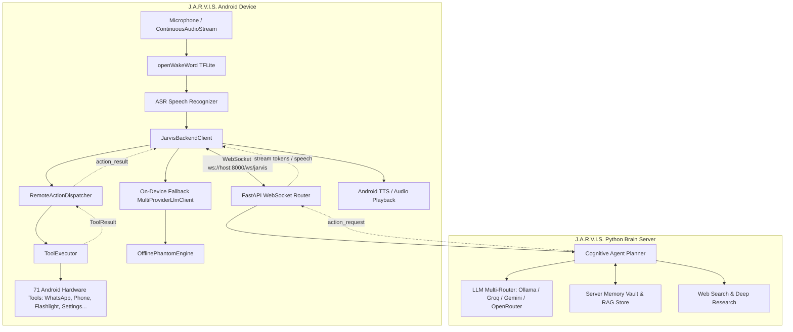

# J.A.R.V.I.S. Dedicated Backend Server & Device Offloading Plan

> **For agentic workers:** REQUIRED SUB-SKILL: Use `superpowers:subagent-driven-development` (recommended) or `superpowers:executing-plans` to implement this plan task-by-task. Steps use checkbox (`- [ ]`) syntax for tracking.

**Goal:** Build and integrate a high-performance Python FastAPI backend server that offloads LLM reasoning, multi-turn cognitive planning, vector memory, and web research from the Android device over a persistent WebSocket/REST link, while preserving local execution of all 71 Android hardware tools and providing automatic offline fallback.

**Architecture:** A hybrid client-server model where the Android APK acts as the hardware actuator and audio listener, and the Python backend acts as the central brain. When connected, voice utterances and device telemetry are streamed over low-latency WebSocket to the backend; the backend performs LLM planning, generates spoken replies, and dispatches remote tool calls (calls, SMS, WhatsApp, flashlight, etc.) back to the APK's `ToolExecutor`. If the backend is disconnected, the APK seamlessly falls back to on-device direct cloud or offline phantom mode.

**Tech Stack:** 
- **Backend:** Python 3.10+, FastAPI, Uvicorn, WebSockets, Pydantic, HTTPX, SQLite / vector store. Supports Ollama (local), Groq (cloud fast), Gemini, OpenRouter.
- **Android Client:** Kotlin, OkHttp 4.12.0 (WebSocket / HTTP), Coroutines / Flow, Android Architecture Components, Google Stitch Material 3 UI.

**Spec:** `docs/ARCHITECTURE.md`, `README.md`, `app/src/main/java/com/jarvis/runtime/AssistantRuntime.kt`.

---

## Global Constraints

- **Zero Breaking Changes to Existing Tools:** All 71 on-device tools (`ToolExecutor`, `ToolRegistry`, `JarvisAccessibilityService`, Telephony, SMS, Flashlight, etc.) must continue functioning without modification to their core logic.
- **Fail-Safe Offline Autonomy:** If the backend server is unreachable, timed out, or unconfigured, the app must automatically fall back to direct cloud LLM (`MultiProviderLlmClient`) or local `OfflinePhantomEngine` without crashing or freezing the user interface.
- **Low Latency:** Voice query to first token stream over local Wi-Fi or LAN must maintain $\le 250\text{ms}$ overhead.
- **Security & Authorization:** Server connection must be authenticated via a configurable Bearer token or pairing PIN to prevent unauthorized network access.
- **Device Battery & CPU Relief:** LLM token generation, long-term memory embeddings, knowledge graph updates, and web searches must run exclusively on the backend server when connected.

---

## Review Focus

1. **Network Disconnection Mid-Turn:** If the WebSocket connection drops while the backend is planning an action, the APK must time out cleanly and offer fallback instead of hanging.
2. **Action Execution Confirmation:** Device hardware tools executed on the phone must return their concrete `ToolResult` back to the server so the backend agent loop receives accurate environment feedback.
3. **Sensitive Local Data Isolation:** Local passwords, keystore secrets, and banking OTPs remain on-device and are never transmitted to the backend unless explicitly requested by the user.
4. **Android Background Doze & Reconnection:** When the phone wakes from deep sleep or reconnects to Wi-Fi, the WebSocket client must automatically reconnect with exponential backoff.
5. **Simultaneous Audio & Token Streaming:** TTS speech synthesis on the phone must begin streaming tokens as soon as the server emits them, maintaining fluid conversational interaction.

---

## Proposed Architecture Overview



---

## Proposed Changes

### Component 1: Python Backend Core (`server/`)

Create a self-contained, high-performance Python FastAPI backend under `server/` with WebSocket routing, device pairing, and REST endpoints.

#### [NEW] `server/requirements.txt`
Dependencies: `fastapi>=0.110.0`, `uvicorn[standard]>=0.28.0`, `pydantic>=2.6.0`, `httpx>=0.27.0`, `python-dotenv>=1.0.0`, `websockets>=12.0`, `pytest>=8.0.0`.

#### [NEW] `server/app/models.py`
Pydantic schemas:
- `ClientMessageType`: `QUERY`, `ACTION_RESULT`, `PING`, `DEVICE_STATE`.
- `ServerMessageType`: `CONNECTED`, `TOKEN`, `ACTION_REQUEST`, `COMPLETED`, `ERROR`, `PONG`.
- `DeviceState`: battery level, charging status, active app, Wi-Fi status.
- `ActionRequest`: `action_id`, `action_name`, `params`, `speech_preamble`.
- `ActionResult`: `action_id`, `success`, `output`, `error_message`.
- `QueryPayload`: `session_id`, `utterance`, `device_state`.

#### [NEW] `server/app/config.py`
Settings class loaded from environment or `.env`:
- `PORT` (default 8000), `HOST` (default `0.0.0.0`).
- `AUTH_TOKEN` (shared secret / PIN).
- `DEFAULT_LLM_PROVIDER`: `ollama`, `groq`, `gemini`, or `openrouter`.
- API keys: `GROQ_API_KEY`, `GEMINI_API_KEY`, `OPENROUTER_API_KEY`, `OLLAMA_BASE_URL`.

#### [NEW] `server/app/llm_router.py`
Unified asynchronous LLM router:
- Connects to Ollama (`http://localhost:11434/api/chat`) for 100% offline local inference on the host machine.
- Connects to Groq, Gemini, or OpenRouter for cloud inference.
- Provides streaming token generator and structured JSON generation.

#### [NEW] `server/app/memory_vault.py`
Persistent conversation memory, user preferences, and fact vault using SQLite and lightweight text search.

#### [NEW] `server/app/agent_planner.py`
Cognitive orchestration loop:
- Receives user query + device state.
- Builds prompt with the 71 canonical Android capabilities.
- Determines whether to emit an immediate answer or a hardware action request (`ACTION_REQUEST`).
- Handles multi-turn tool interaction (plan -> action -> observation -> conclusion).

#### [NEW] `server/app/main.py`
FastAPI app:
- `WebSocket /ws/jarvis`: Full-duplex connection for mobile client.
- `GET /api/health`: Status, connected devices, active LLM provider.
- `POST /api/chat`: REST fallback for standard Q&A.
- `POST /api/vision`: Multimodal image perception endpoint.
- `GET /api/tools`: Catalog of available tools and schemas.

#### [NEW] `server/run_server.sh`
Bash script to set up virtual environment, install requirements, and run Uvicorn.

#### [NEW] `server/tests/test_server_core.py`
Pytest tests for health endpoint, auth validation, and WebSocket communication.

---

### Component 2: Android APK Backend Networking & Action Dispatcher (`com.jarvis.backend`)

Implement the client networking layer inside the Android app to connect to the backend server.

#### [NEW] `app/src/main/java/com/jarvis/backend/BackendModels.kt`
Kotlin data classes matching the server JSON protocol:
- `BackendMessage`, `ActionRequestMessage`, `ActionResultMessage`, `QueryMessage`, `ServerEvent`.

#### [NEW] `app/src/main/java/com/jarvis/backend/JarvisBackendClient.kt`
- Manages OkHttp `WebSocket` connection to `ws://<server_url>/ws/jarvis`.
- Connection lifecycle: connect, disconnect, auto-reconnect with exponential backoff (1s, 2s, 4s, up to 30s).
- Heartbeat: periodic ping every 15 seconds.
- Handles incoming messages:
  - `TOKEN`: invokes streaming listener for real-time TTS.
  - `ACTION_REQUEST`: dispatches to `RemoteActionDispatcher`.
  - `COMPLETED`: resolves query execution job.
- Thread-safe query dispatch: `suspend fun sendQuery(utterance: String, state: DeviceState): Result<String>`.

#### [NEW] `app/src/main/java/com/jarvis/backend/RemoteActionDispatcher.kt`
- Receives `ActionRequestMessage` from backend.
- Invokes `ToolExecutor.execute(action, params)`.
- Sends `ActionResultMessage` back over WebSocket with execution status and output.

#### [NEW] `app/src/main/java/com/jarvis/backend/BackendLlmClient.kt`
- Implements `LlmClient` interface.
- Translates `chat()` calls to backend server requests, enabling drop-in compatibility with all existing app subsystems (`LlmPlanner`, `WhatsAppMessagingEngine`, `VisualQnaEngine`, etc.).

---

### Component 3: Runtime Integration & Fail-Safe Offline Fallback

Integrate the backend client into `AssistantRuntime.kt` with automatic fallback.

#### [MODIFY] `app/src/main/java/com/jarvis/ui/model/UiModels.kt`
Add backend settings to `AppSettings`:
```kotlin
val backendServerEnabled: Boolean = false,
val backendServerUrl: String = "ws://192.168.1.100:8000/ws/jarvis",
val backendAuthToken: String = "",
val backendFallbackToDirect: Boolean = true,
val backendUseRestFallback: Boolean = true
```

#### [MODIFY] `app/src/main/java/com/jarvis/ui/data/UiPreferencesStore.kt`
Add JSON serialization and deserialization for backend fields in `jsonToAppSettings` and `AppSettings.toJson()`.

#### [MODIFY] `app/src/main/java/com/jarvis/runtime/AssistantRuntime.kt`
- Initialize `JarvisBackendClient` when `backendServerEnabled` is true.
- In `executeCommandInternal`:
  1. If `backendServerEnabled` and `backendClient.isConnected`:
     - Dispatch command to backend server over WebSocket.
     - Backend streams tokens and sends action requests.
     - APK executes requested actions via `toolExecutor`.
  2. If backend connection fails or times out:
     - Log warning and seamlessly fall back to local `executeCommandInternal` (direct cloud LLM or `OfflinePhantomEngine`).
     - Display subtle toast or HUD notice: `"Server offline - running on local fallback"`.

---

### Component 4: Settings UI — Backend Server Configuration Deck

Provide user controls in the Android app to configure, test, and monitor the backend connection.

#### [MODIFY] `app/src/main/java/com/jarvis/ui/screens/SettingsScreen.kt`
Add **"JARVIS BACKEND SERVER BRIDGE"** cyber-slate card:
- Switch: **Enable Backend Server** (toggle on/off).
- Text Input: **Server URL** (e.g., `ws://192.168.1.50:8000/ws/jarvis` or `wss://jarvis.yourdomain.com`).
- Text Input: **Pairing Token / Secret Key** (masked).
- Button: **Test Connection / Ping** with live latency indicator (e.g. `🟢 Connected (14ms)` or `🔴 Unreachable`).
- Switch: **Auto-Fallback to Cloud/Local if Server Disconnected**.

---

## Detailed Task Breakdown

### Task 1: Python Backend Core Service
**Files:**
- Create: `server/requirements.txt`
- Create: `server/app/models.py`
- Create: `server/app/config.py`
- Create: `server/app/main.py`
- Create: `server/run_server.sh`
- Test: `server/tests/test_server_core.py`

**Interfaces:**
- Consumes: Python standard library, FastAPI, WebSockets.
- Produces: Running HTTP/WebSocket server listening on port 8000 with `/api/health` and `/ws/jarvis`.

- [ ] **Step 1: Write the failing server test**
- [ ] **Step 2: Run pytest to verify it fails**
- [ ] **Step 3: Implement `models.py`, `config.py`, and `main.py`**
- [ ] **Step 4: Run pytest to verify it passes**
- [ ] **Step 5: Commit server core**

### Task 2: Backend LLM Orchestration & Remote Action Planner
**Files:**
- Create: `server/app/llm_router.py`
- Create: `server/app/memory_vault.py`
- Create: `server/app/agent_planner.py`
- Test: `server/tests/test_agent_planner.py`

**Interfaces:**
- Consumes: `server/app/models.py`, `server/app/config.py`.
- Produces: `AgentPlanner.plan_and_execute(query, device_state)` yielding tokens and action requests.

- [ ] **Step 1: Write test for agent planning and action dispatch**
- [ ] **Step 2: Run pytest to verify it fails**
- [ ] **Step 3: Implement LLM router, memory vault, and agent planner**
- [ ] **Step 4: Run pytest to verify it passes**
- [ ] **Step 5: Commit agent planner**

### Task 3: Android APK Backend Networking & Action Dispatcher
**Files:**
- Create: `app/src/main/java/com/jarvis/backend/BackendModels.kt`
- Create: `app/src/main/java/com/jarvis/backend/JarvisBackendClient.kt`
- Create: `app/src/main/java/com/jarvis/backend/RemoteActionDispatcher.kt`
- Create: `app/src/main/java/com/jarvis/backend/BackendLlmClient.kt`
- Test: `app/src/test/java/com/jarvis/backend/JarvisBackendClientTest.kt`

**Interfaces:**
- Consumes: OkHttp `WebSocketListener`, `ToolExecutor`, `LlmClient`.
- Produces: `JarvisBackendClient` and `RemoteActionDispatcher`.

- [ ] **Step 1: Write unit tests for client serialization and action handling**
- [ ] **Step 2: Run `./gradlew testDebugUnitTest --tests com.jarvis.backend.*` to verify failure**
- [ ] **Step 3: Implement backend client and action dispatcher**
- [ ] **Step 4: Run `./gradlew testDebugUnitTest --tests com.jarvis.backend.*` to verify pass**
- [ ] **Step 5: Commit backend networking layer**

### Task 4: Runtime Integration & Fail-Safe Fallback
**Files:**
- Modify: `app/src/main/java/com/jarvis/ui/model/UiModels.kt`
- Modify: `app/src/main/java/com/jarvis/ui/data/UiPreferencesStore.kt`
- Modify: `app/src/main/java/com/jarvis/runtime/AssistantRuntime.kt`
- Test: `app/src/test/java/com/jarvis/runtime/BackendRuntimeFallbackTest.kt`

**Interfaces:**
- Consumes: `JarvisBackendClient`, `UiPreferencesStore`.
- Produces: Dual-mode execution in `AssistantRuntime.executeCommand`.

- [ ] **Step 1: Write unit test verifying fallback when backend is disconnected**
- [ ] **Step 2: Run test to verify failure**
- [ ] **Step 3: Wire `JarvisBackendClient` into `AssistantRuntime` with fail-safe fallback**
- [ ] **Step 4: Run test to verify pass**
- [ ] **Step 5: Commit runtime integration**

### Task 5: Settings UI Configuration Deck
**Files:**
- Modify: `app/src/main/java/com/jarvis/ui/screens/SettingsScreen.kt`
- Test: `app/src/test/java/com/jarvis/ui/data/UiPreferencesStoreBackendTest.kt`

**Interfaces:**
- Consumes: `UiPreferencesStore`, `JarvisBackendClient`.
- Produces: UI card for server URL, token, toggle, and ping latency test.

- [ ] **Step 1: Write unit tests for preference persistence**
- [ ] **Step 2: Run test to verify pass**
- [ ] **Step 3: Add Backend Server card to `SettingsScreen.kt`**
- [ ] **Step 4: Verify build with `./gradlew compileDebugSources`**
- [ ] **Step 5: Commit UI updates**

### Task 6: Full Integration Verification
**Files:**
- End-to-end test script: `scripts/test_backend_connection.py`

- [ ] **Step 1: Run full unit test suite `./gradlew testDebugUnitTest`**
- [ ] **Step 2: Run server unit test suite `pytest server/tests`**
- [ ] **Step 3: Test end-to-end interaction (FastAPI backend + Android client mockup)**
- [ ] **Step 4: Verify release APK assembly `./gradlew assembleDebug`**

---

## Verification Plan

### Automated Tests
1. **Backend Server Tests:**
   ```bash
   cd server && pytest tests/ -v
   ```
   - `test_health`: Verifies status 200 and available model engines.
   - `test_websocket_auth`: Verifies unauthorized connection rejected, valid token accepted.
   - `test_action_roundtrip`: Verifies `query` -> `ACTION_REQUEST` -> `ACTION_RESULT` -> `COMPLETED`.
   
2. **Android Unit Tests:**
   ```bash
   JAVA_HOME=/home/shanu/jdk/jdk-17.0.13+11 PATH=$JAVA_HOME/bin:$PATH ./gradlew testDebugUnitTest
   ```
   - `JarvisBackendClientTest`: Message formatting, token streaming parsing, action dispatch.
   - `BackendRuntimeFallbackTest`: Confirms seamless fallback when backend times out.
   - `UiPreferencesStoreBackendTest`: Confirms server settings persist cleanly.

3. **APK Build Verification:**
   ```bash
   JAVA_HOME=/home/shanu/jdk/jdk-17.0.13+11 PATH=$JAVA_HOME/bin:$PATH ./gradlew assembleDebug
   ```

### Manual Verification
1. Start the server on local PC:
   ```bash
   bash server/run_server.sh
   ```
2. Open JARVIS app on Android -> Navigate to **CONFIG** (Settings Screen) -> Scroll to **Backend Server Bridge**.
3. Enter PC IP (e.g. `ws://192.168.1.50:8000/ws/jarvis`) and click **Test Connection** -> Verify green "Connected" badge with ping latency.
4. Voice test: Speak "Turn on flashlight" or "Call Papa" -> Verify backend server logs the query, phone executes the flashlight/call locally, and spoken confirmation is heard.
5. Disconnect test: Stop the server -> Speak a command -> Verify phone seamlessly announces and handles command using on-device direct cloud / offline phantom fallback.
